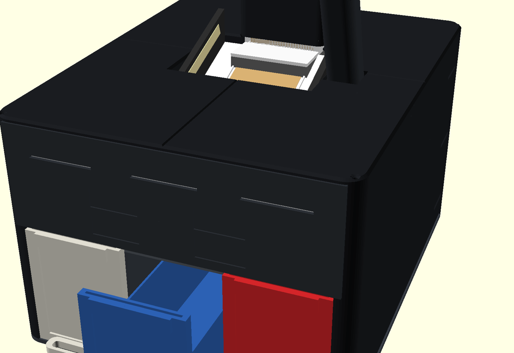
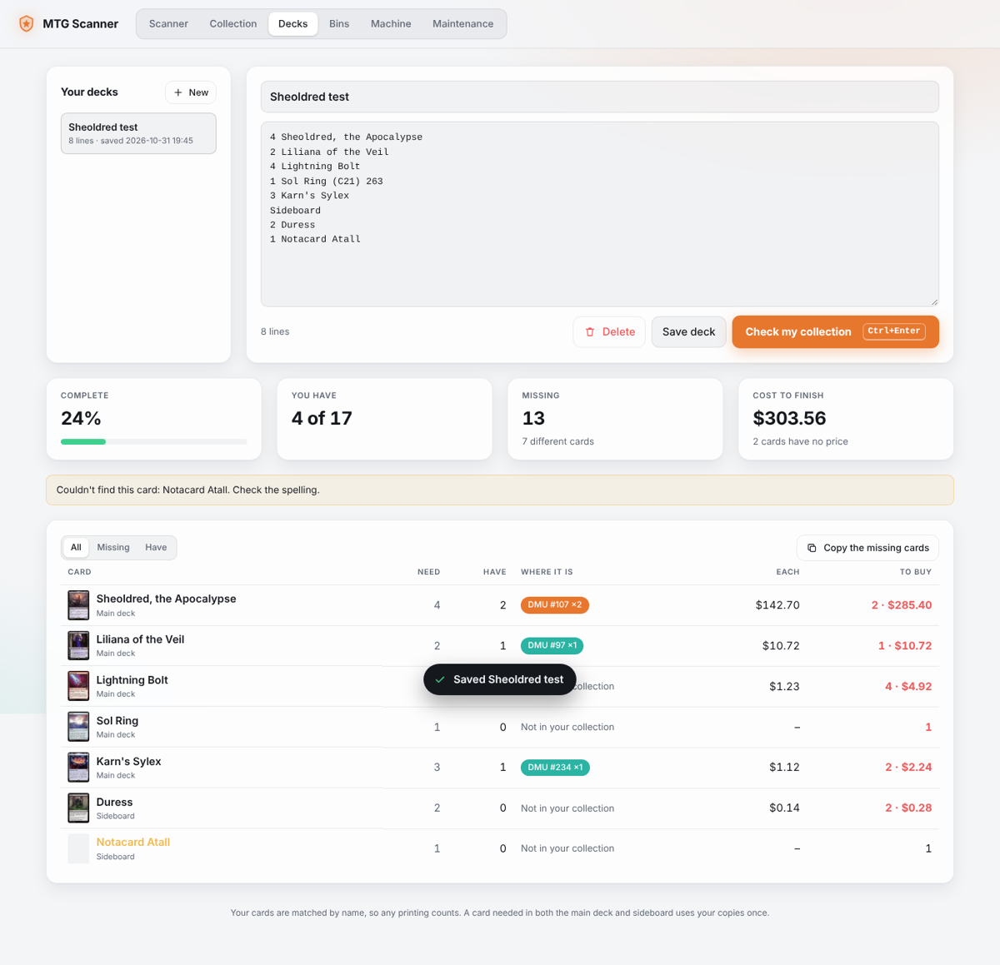
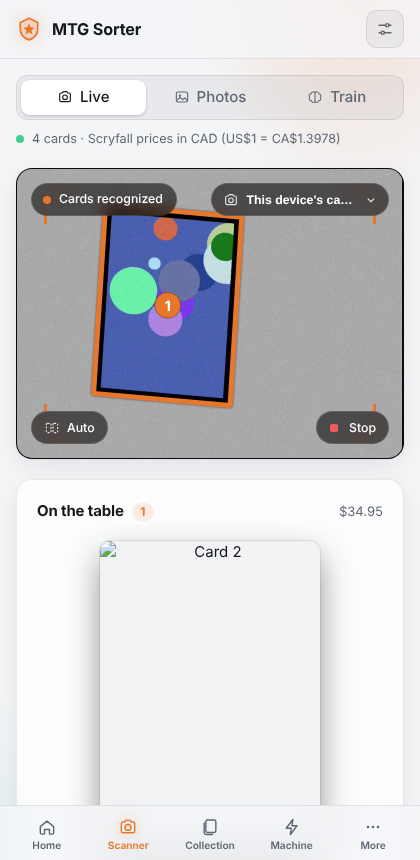
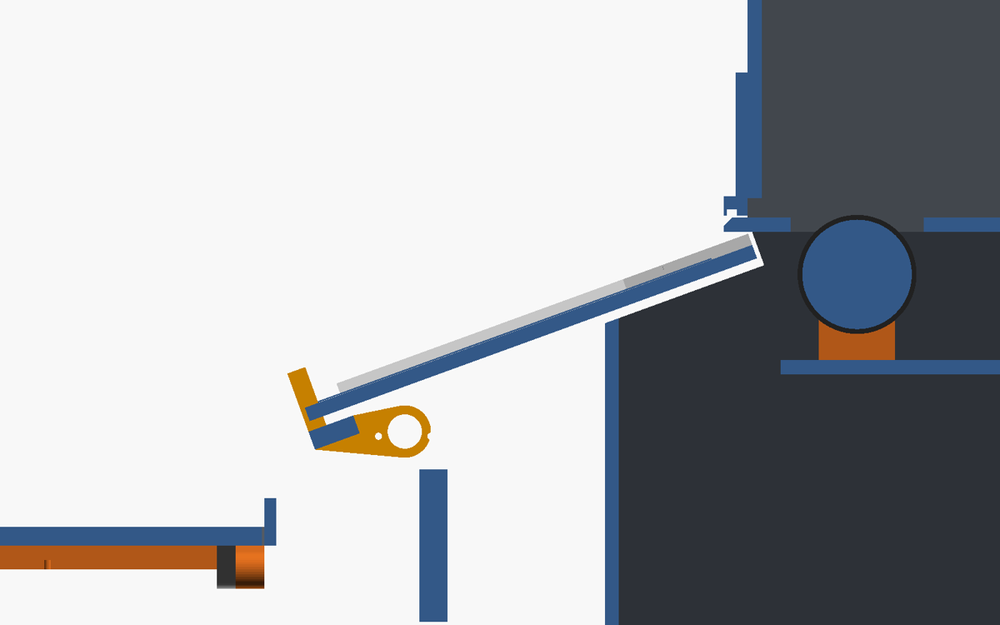
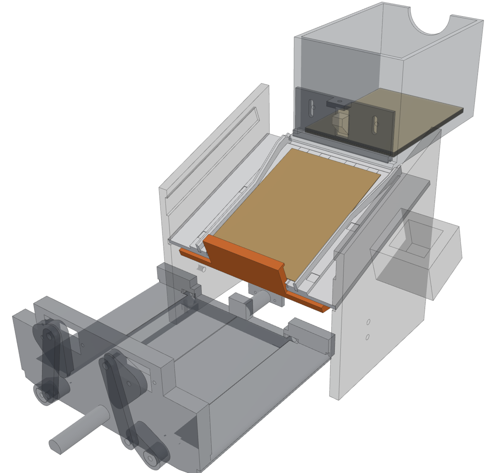
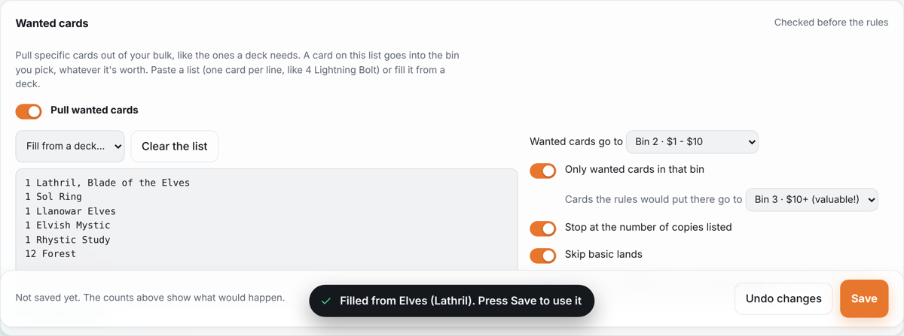
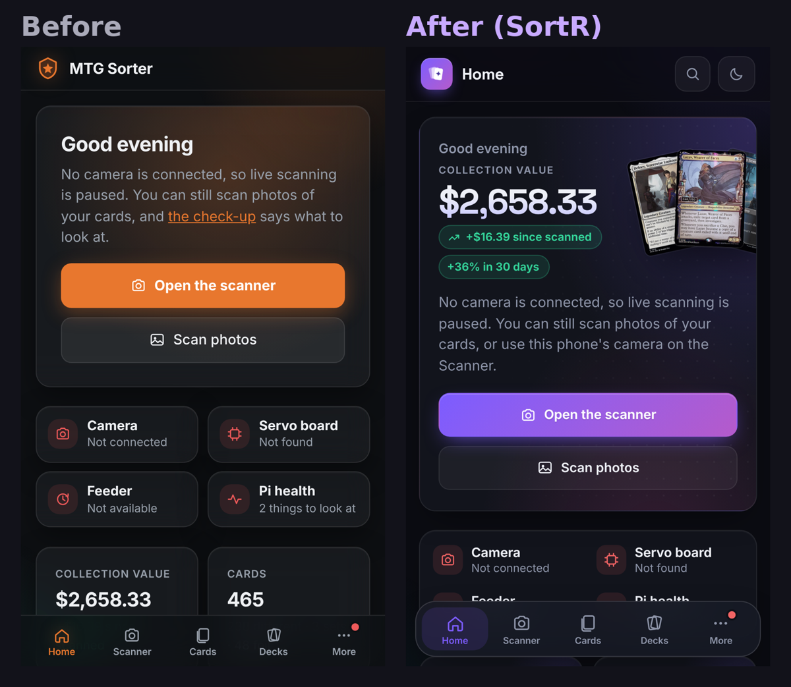
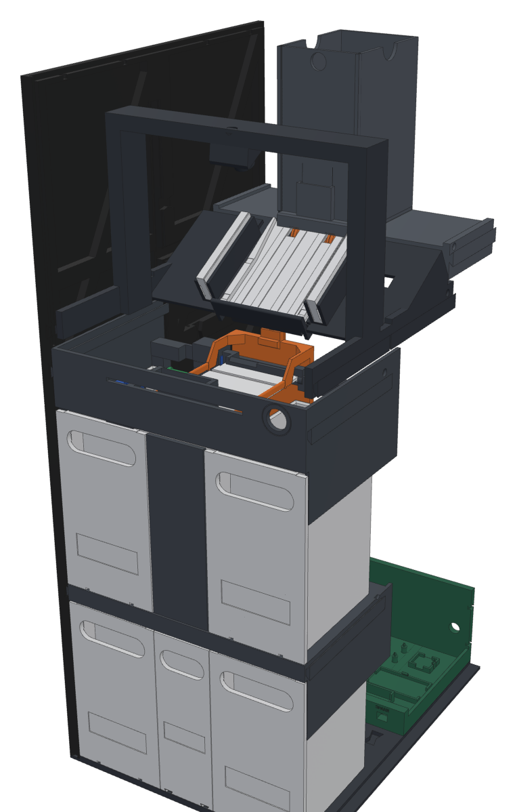

# SortR devlog

A week-by-week log of building SortR: the card scanner, the sorting machine and the web
app. Each week covers what I built, the problems I ran into and how I solved them, what I
learned, and screenshots and code from the milestones.

Weeks run Monday to Sunday. Pull request numbers (#NN) link the work to the code.

| Week | Dates | Headline |
|---|---|---|
| [1](#week-1-oct-19-to-25-the-scanner-and-the-first-enclosure) | Oct 19 to 25 | The scanner reads cards; first enclosure design |
| [2](#week-2-oct-26-to-nov-1-the-machine-moves-and-the-web-app-grows) | Oct 26 to Nov 1 | The machine moves; the web app grows to a dozen pages |
| [3](#week-3-nov-2-to-8-a-server-phones-and-a-sorter-that-runs-on-its-own) | Nov 2 to 8 | Home server, phone scanning, accounts, the sorter runs on its own |
| [4](#week-4-nov-9-to-15-ghost-cards-a-broken-bed-mk2-and-sortr) | Nov 9 to 15 | Ghost cards, a broken bed, the Mk2 redesign and the SortR app |
| [5](#week-5-nov-16-to-22-phone-scanning-accuracy-and-the-capstone-plan) | Nov 16 to 22 | Phone scanning accuracy and the capstone plan (in progress) |

---

## Week 1: Oct 19 to 25. The scanner and the first enclosure

**Progress**

- Wrote the scanner: it finds a card in a camera picture, straightens it, and identifies it
  against a database built from [Scryfall](https://scryfall.com) card pictures.
- Ran a full test pass on the scanner software (60 tests by the end of the week).
- Moved the scanner onto the Raspberry Pi 5 with its Camera Module 3, and made the Pi keep
  itself up to date from GitHub (#9, #10).
- Designed a sleek enclosure in OpenSCAD, sized to the Card Catalog storage drawers I use as
  bins, and set it up as one Bambu Studio project with every plate ready to print (#11, #12, #15).
- Wrote PRINTING.md with the print order and slicer settings (#13).

**Challenges and how I solved them**

- *How do you recognise one card out of 100,000+ printings without machine learning?* I
  used perceptual hashes: shrink the straightened card, turn it into a 256-bit fingerprint,
  and find the closest fingerprint in the database. Similar pictures give similar
  fingerprints even with blur or different lighting.
- *A pull request merged into a stale branch* and the test pass never reached main. I
  learned to check the base branch before merging, closed the duplicate and re-merged
  it properly (#9).

**What I learned**

- Perceptual hashing is a simple, fast way to match images and needs no training data.
- Designing in code (OpenSCAD) means one measurement change updates every part that
  depends on it, so the drawers' size lives in one place.



---

## Week 2: Oct 26 to Nov 1. The machine moves and the web app grows

**Progress**

- Printed and assembled the enclosure from a picture assembly guide I made from the model.
- Built the web app around the scanner with Flask: the app starts without a camera and
  says so (#20), a Machine page tests the servos and feeder (#19), and then Maintenance,
  Collection with live Scryfall prices, Decks, Bins (sorting rules), Wishlist, PIN lock,
  Home dashboard, Lights and Sets pages (#22 to #27, #30).
- Folded my older Commander Vault collection app into SortR so there is one app (#29).
- Redesigned the chute: door carriers replaced separate hinge mounts, and the whole chute
  prints on one plate.

**Challenges and how I solved them**

- *The Pi went solid red and wouldn't boot.* A cheap camera-cable extension board had its
  pins mirrored and shorted the Pi. I removed it, reflashed the Pi and redid the setup. The
  extension never goes back in.
- *Servos smoked and the feeder died.* I had plugged a 12 V adapter into the 5 V system.
  The servos and motor driver were gone, but the Pi and the servo board chip survived. I
  replaced the servos and driver, and the rule now is 5 V only, never 12 V without a
  converter.
- *After merging the Lights page, every page showed two headers.* Two pages had added the
  same menu code. I moved the page menu into one shared script used by every page (#28).

**What I learned**

- Check power and cables before blaming code. Both of this week's big failures were wiring.
- Splitting the app into one module per page (`mtgscanner/decks.py`, `bins.py`, and so on,
  each adding its own routes) kept a fast-growing app manageable.

```python
# app.py: each page module registers its own routes on the Flask app
add_collection_routes(app, scanner, WEB)  # the /collection page
add_deck_routes(app, scanner, WEB)        # the /decks page
add_lights_routes(app, scanner.lights, WEB)  # the /lights page
```



---

## Week 3: Nov 2 to 8. A server, phones, and a sorter that runs on its own

**Progress**

- Packaged the app as a Docker image built by GitHub Actions, and ran it on my Unraid home
  server so every device shares one collection (#39).
- Added scanning with any device's own camera: a phone sends pictures to the server, and
  several phones can scan at once (#39, #41, #42).
- Added user accounts with permissions and invite links (#43), phone polish and Add to
  Home Screen icons, and Montreal store prices (#46).
- Made recognition much stronger: a second fingerprint of just the art, exact card edges,
  and a button that downloads every card (108,000 printings) (#47).
- Ran the Pi on the same Docker image as the server (#48 to #50).
- Rebuilt the mechanism (v2) and chute (v3) (#52), then made the sorter fully automatic: feed one
  card while watching the camera (#67), sort it to a bin, a tuning run, and finally
  **Start sorting**, which feeds, recognises, saves and bins cards on its own (#75).
- Added a scan bed (v3) that centres cards, and a "wanted cards" bin that pulls a list out
  of the bulk (#88).

**Challenges and how I solved them**

- *The camera was never detected.* I swapped the camera and checked the software, power and
  I2C lines. It turned out to be a borderline ribbon cable, and then a protective film on
  the lens that made everything foggy. Inside Docker, the camera also needed `/dev/dma_heap`
  passed in, and the app had to release a camera that failed to open (#61).
- *The feeder gave 0, 1 or 3 cards per push.* I recorded the camera at 25 fps during each
  feed and found the wheels sat 20 mm behind the gate, so each card's tail stayed under the
  stack. Instead of a timed push, the feeder now watches the camera, stops when a card
  lands, and backs off to pull the next card back (#67, #69).
- *The Pi kept freezing during runs.* It was at 84 to 86 °C and throttling with no fan, and
  the scanner used about 2.4 CPU cores. An active cooler brought it to 44 °C, and the
  scanner now idles at a low frame rate when nothing is happening (#77).
- *One release broke the whole Scanner page.* A helper was declared twice in `app.js`,
  which stops the entire script. I added a test that parses every page script with Node so
  this can't ship again (#79).
- *Foils weren't recognised.* Glare from the light bars hid the card. The scanner now paints
  over the brightest patches and looks again, and takes a second look with the bars dimmed.
- *Cards were read in pieces.* The art box or text box was being tracked as a card. A
  "Whole cards only" mode measures the card on the bed and ignores anything smaller (#94).

**What I learned**

- Recording and measuring (frame by frame, temperatures, CPU) found causes much faster than
  guessing.
- A closed loop (stop the motor when the camera sees the card) beats a carefully tuned timer.
- Every bug that reached the machine got a test so it stays fixed.

```python
# tests/test_app.py: a syntax error in a page script kills the whole page,
# so every script is parsed with Node on each test run.
for script in sorted(webui.glob("*.js")):
    check = subprocess.run([node, "--check", str(script)], capture_output=True, text=True)
    assert check.returncode == 0, f"{script.name}: {check.stderr.strip()}"
```

**Result:** the final run of the week fed 125 cards with 0 double feeds and recognised 83%
of them, with the room lights off.






---

## Week 4: Nov 9 to 15. Ghost cards, a broken bed, Mk2 and SortR

**Progress**

- Improved recognition on the bed: try the bed's known card spot as an outline, and boost
  contrast when unsure (#101). A run after these fixes read 54 of 55 cards (98%).
- Measured throughput over 979 cards: about 300 to 400 cards an hour.
- The tilting bed on the first machine broke on Nov 9. Rather than patch it, I designed
  **Mk2**: a full screwless rebuild with slide-in dovetail modules, four bins plus a
  catch-all, a 400-card magazine and one plug (#109 to #111), with print presets and a
  22-step picture assembly guide (#114).
- Renamed the app **SortR** and redesigned it: sidebar, phone tab bar, search everything
  with Ctrl K, and a Home dashboard with charts (#113).
- Fixed a crash in the command-line scanner's webcam mode (#116).

**Challenges and how I solved them**

- *The empty bed was read as a card.* The server's Scanner tab kept saving "Precise
  Redaction" while the bed was empty: the bed's ribs looked like that card's fingerprint.
  I fixed it in steps. First, a bed-only outline had to match a real card (#103). Then the
  app remembered the empty bed's fingerprint (#104, #105). That still failed when the light
  bars dipped, so the final fix compares the *pattern* of the ribs, which stays the same
  whatever the brightness (#108). I removed the 143 ghost copies from the collection after
  backing it up.
- *Some Mk2 plates came out as "G-code beyond plate".* Pressing Arrange in the slicer moved
  parts off the bed. The plates are now centred with room for brims (#112).

```python
# app.py: brightness-proof check for the bare bed (normalised correlation)
def look_likeness(a, b) -> float:
    """How alike two _bed_look pictures are, -1 to 1, whatever their brightness and contrast."""
    a = a.astype(np.float32).ravel()
    b = b.astype(np.float32).ravel()
    a -= a.mean()
    b -= b.mean()
    n = float(np.linalg.norm(a) * np.linalg.norm(b))
    return float(a @ b) / n if n > 1e-6 else 0.0
```

**What I learned**

- A fix that works in one light can fail in another. Test the edge cases (dim light,
  moving parts) on purpose.
- Back up data before any clean-up. The ghost copies were removed only after a backup.
- Sometimes a redesign is better than another patch: Mk2 drops every screw that caused
  trouble on the first machine.




---

## Week 5: Nov 16 to 22. Phone scanning accuracy and the capstone plan

*In progress.*

**Progress**

- The phone camera now comes back by itself after the browser pauses it (#118).
- The scanner rebuilds a whole card from its straight sides when a thumb or the picture's
  edge breaks the outline (#119). On 1,176 test photos, right answers went from 77% to 97%.
- It nudges outlines onto the card and tells look-alike printings apart by comparing the
  scan with Scryfall's pictures only where the printings differ (#120). Right card went
  from 97.5% to 99.1%, and right printing from 91% to 95%, with no wrong cards.
- Cleaned up the repository and docs (#122).
- Checked the project against the capstone rubric and wrote the proposal: a React Native
  phone app with a Node and Express API and MongoDB, using the scanner as a service.

**Challenges and how I solved them**

- *The phone scanner kept locking onto pieces of a card.* Given the true outline, the same
  photos were read 99% of the time, so the outline was the whole problem. The fix finds
  the card's straight sides and rebuilds the rectangle from three or four of them.
- *Reprints look almost identical to the fingerprint.* The fix compares the scan with each
  printing's stock picture only where they differ, such as the set symbol and the small
  print at the bottom.

```python
# mtgscanner/vision.py: rebuild a card from the straight sides of a broken outline
def _cards_from_sides(pts, near, min_area, shape):
    """Card-shaped outlines made from the straight stretches of a broken outline, each
    with how well it fits: (fit, corners), best first, two at most."""
```

**What I learned**

- Find the part of the pipeline that fails before tuning it. Testing with the perfect
  outline showed recognition itself was fine.
- Measure on a fixed set of test photos so every change can be compared fairly.

**Next week**

- Get the proposal approved.
- Start the Express API with logins and MongoDB, with tests.

---

## Template for new weeks

```markdown
## Week N: <dates>. <headline>

**Progress**
- What I built, with PR numbers.

**Challenges and how I solved them**
- *The problem.* How I tracked it down, what fixed it.

**What I learned**
- Lessons in my own words.

<screenshot> and a short code snippet from the week's main change.

**Next week**
- What's planned.
```
