# Picture assembly guide

How the enclosure build goes together, one picture per step. Every picture is drawn from the same CAD the STLs come from (`guide/scenes.scad`), so it shows the real parts in their real places. **Grey** is already fitted, **orange** is what the step adds, **pink arrows** show where it goes, and numbered circles match the numbers in the text. The longer text version, with the Pi setup and the feeder test, is [`ASSEMBLY.md`](ASSEMBLY.md); print order and settings are in [`PRINTING.md`](PRINTING.md).

A single-file version with the pictures inside: [`assembly_guide.html`](assembly_guide.html) (download it and open it in a browser).

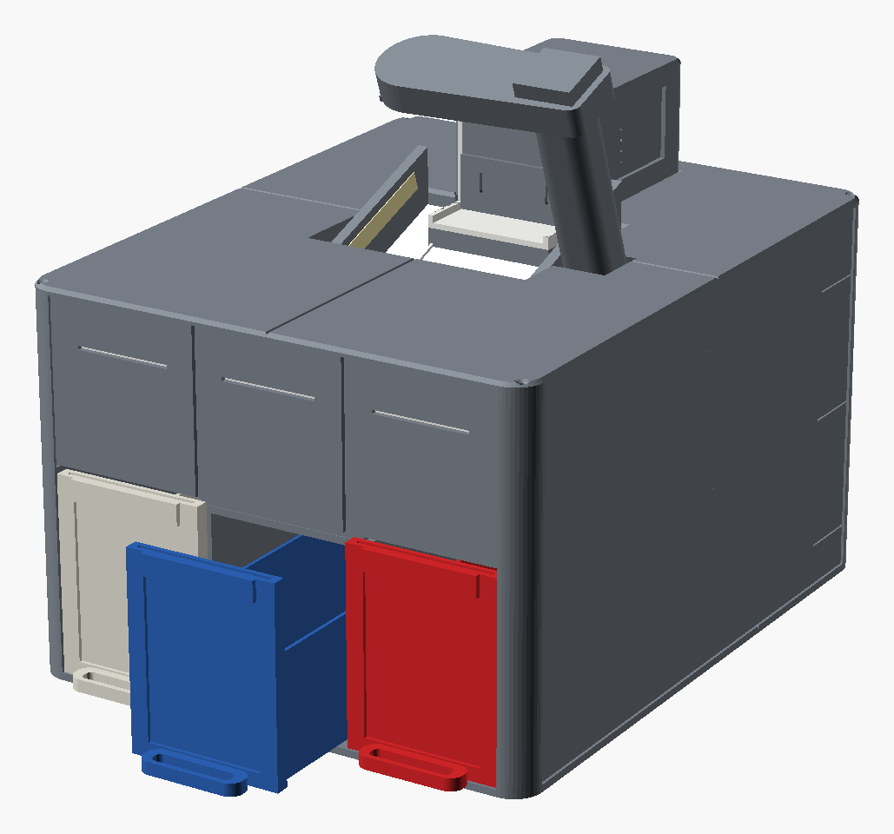

> **Centre every servo before its horn goes on.** Plug it into the PCA9685, set it to 90° with the snippet below, then press the horn on. Otherwise the part it moves ends up at the wrong angle.
>
> ```python
> from adafruit_servokit import ServoKit
> kit = ServoKit(channels=16)
> kit.servo[0].angle = 90   # channel, angle
> ```

## The box

Floor, electronics, walls. Build it on the table where the machine will live.

### 1. Join the floor

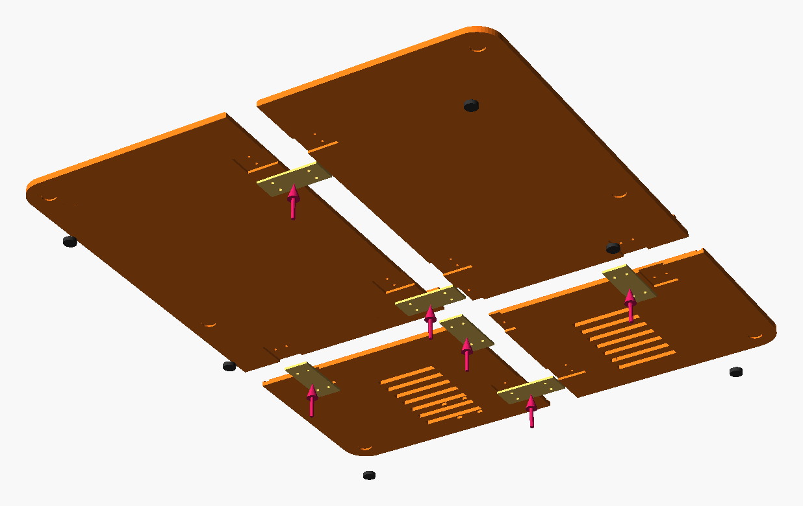

- Lay the four floor tiles upside down and push them together.
- Put a `splice` in each of the six pockets across the seams and fix it with M2 screws or a drop of CA glue.
- Stick a rubber foot in each of the six round recesses.
- Turn it over. The grooves on top are where the drawers run.

**Parts:** `floor_fl`, `floor_fr`, `floor_bl`, `floor_br`, `6 × splice`  
**You need:** 6 × rubber feet, 8 mm, M2 × 6 or CA glue

### 2. Electronics on the floor

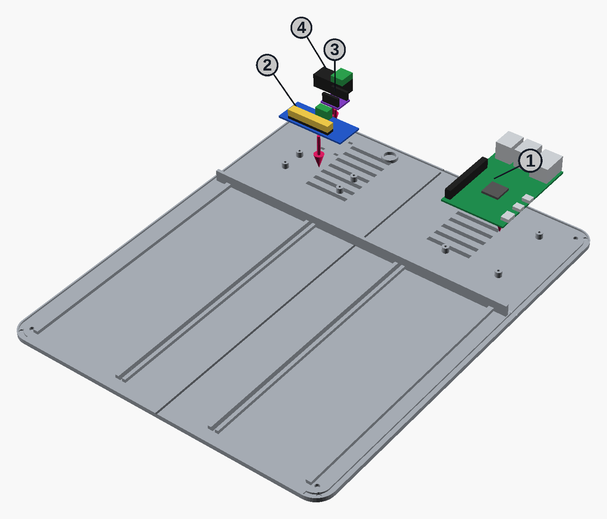

- **(1)** Raspberry Pi 5 on the four standoffs at the back right, ports facing the back.
- **(2)** PCA9685 servo board on the four standoffs at the back left.
- **(3)** DRV8833 motor driver: a zip tie through the slots beside the servo board.
- **(4)** Barrel-jack screw adapter next to the small cut-out at the back left corner. The 5 V adapter cable and the Pi's USB-C cable come in through that cut-out.
- Plug the servo and motor wires in later, in step 16.

**You need:** 8 × M2.5 × 6 (Pi and PCA9685), 1 zip tie

### 3. Corner posts

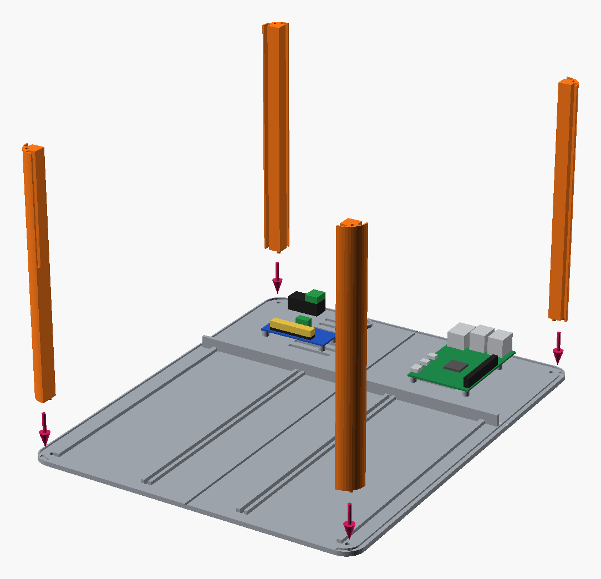

- Push each post onto its two pegs at a corner of the floor. They go on by hand.
- The front posts have one groove that stops 115 mm short of the floor, where the drawers slide past. `post_front` goes front left, `post_front_r` front right: they are mirror images, so two of the same won't do.
- A loose post gets a drop of CA glue on its pegs.

**Parts:** `post_front (left)`, `post_front_r (right)`, `2 × post_back`

### 4. Back panel

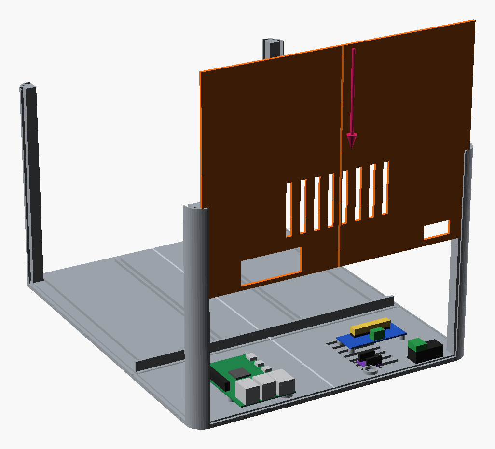

- On the bench, glue `back_l` and `back_r` together with four splices in the pockets on the inside face.
- Slide it down the grooves of the two back posts until it sits in the floor groove.
- The big cut-out lines up with the Pi's USB and network ports, the small one with the power cut-out.

**Parts:** `back_l`, `back_r`, `4 × splice`  
**You need:** CA glue

### 5. Sides

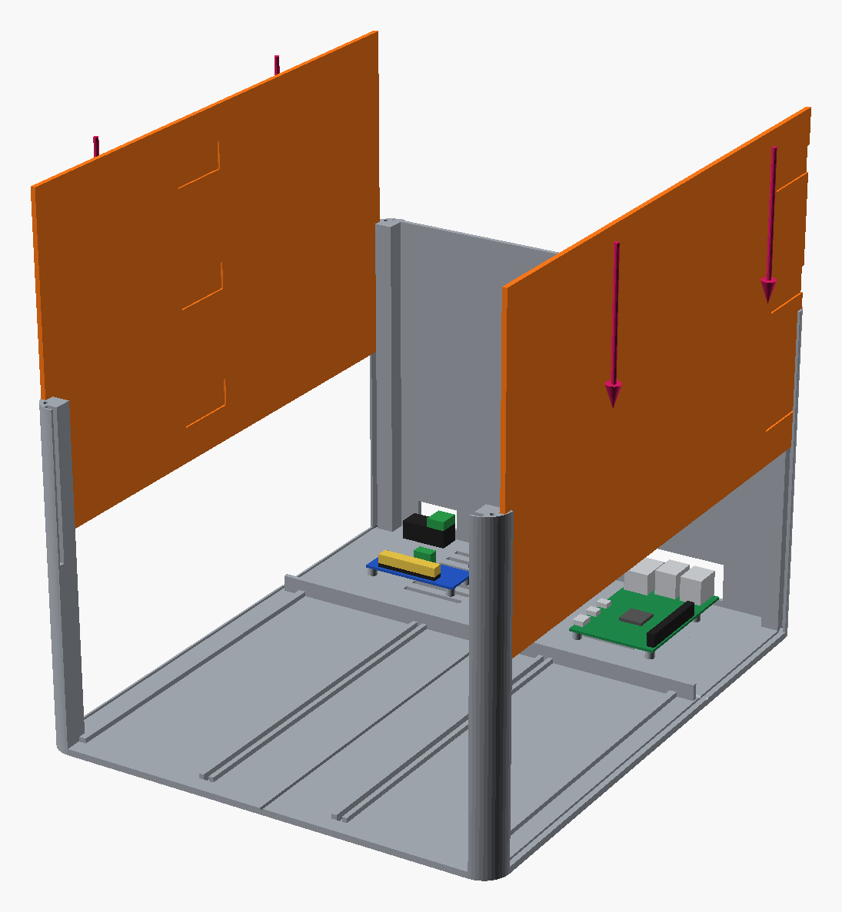

- Each side is two `side` pieces end to end. Flip the second one end for end so both pockets meet at the joint, facing in.
- Glue three splices across the joint.
- Slide each side down between its front and back post.

**Parts:** `4 × side`, `6 × splice`  
**You need:** CA glue

### 6. Build the fascia

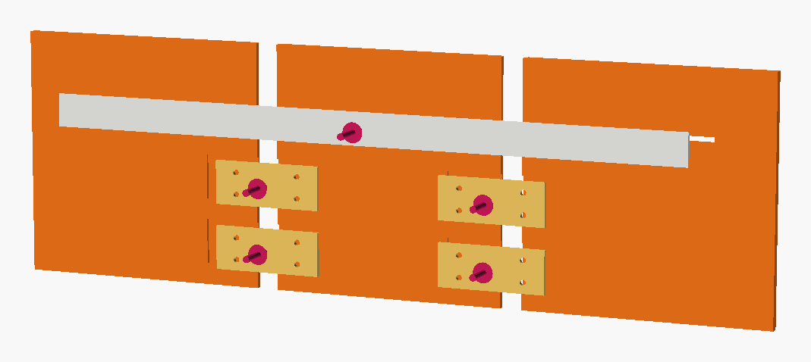

- Lay the three fascia pieces face down, pockets up. The two end pieces are mirror images, so either goes at either end.
- Glue two splices across each seam (four in all).
- Glue the white `light_bar` across the top, over the three light slots. It also ties the pieces together.

**Parts:** `fascia_l`, `fascia_m`, `fascia_r`, `light_bar`, `4 × splice`  
**You need:** CA glue

### 7. Fascia on

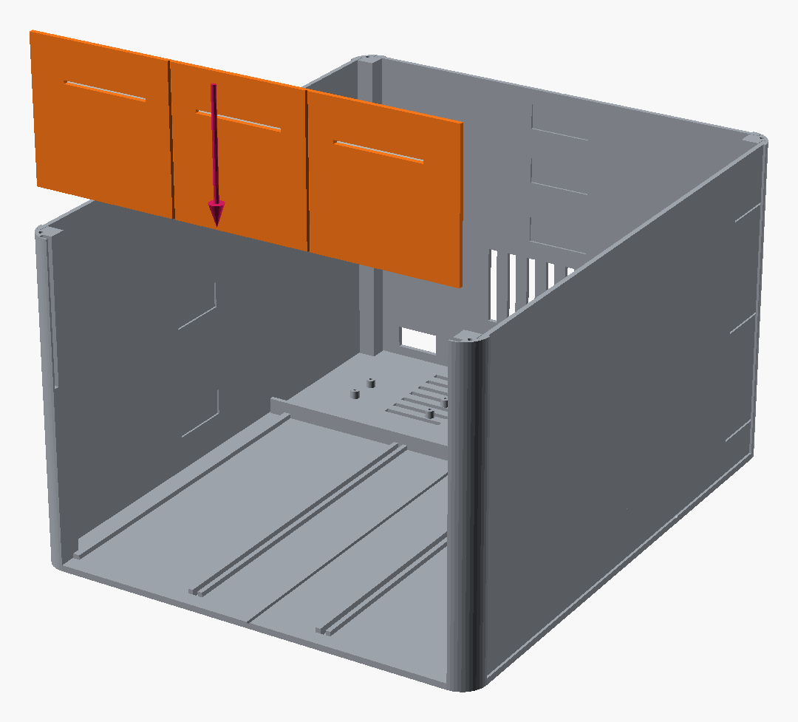

- Slide the fascia down the front posts' grooves, light slots at the top and the light bar on the inside.
- It stops 114 mm above the floor. The drawers go under it.

### 8. Dividers and rear legs

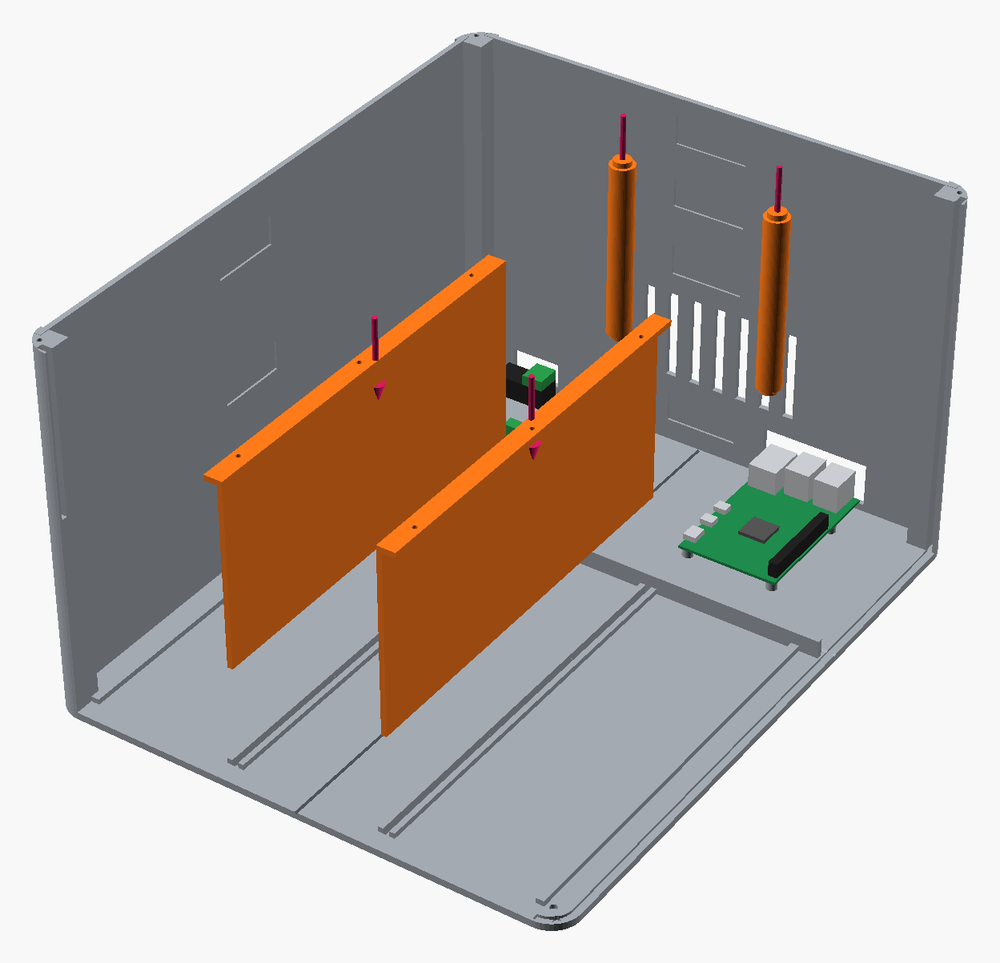

- Stand a `divider` in the groove along each middle curb, its top flange reaching out toward the side wall. It stands on its own.
- Drop a `leg` onto each of the two round bosses at the back of the floor.
- The flanges and the legs carry the bridge in step 16.

**Parts:** `2 × divider`, `2 × leg`

## The mechanism, on the bridge

Build this on the bench and test it before it goes into the box. It's Part 2 of ASSEMBLY.md, standing on the bridge.

### 9. Join the bridge

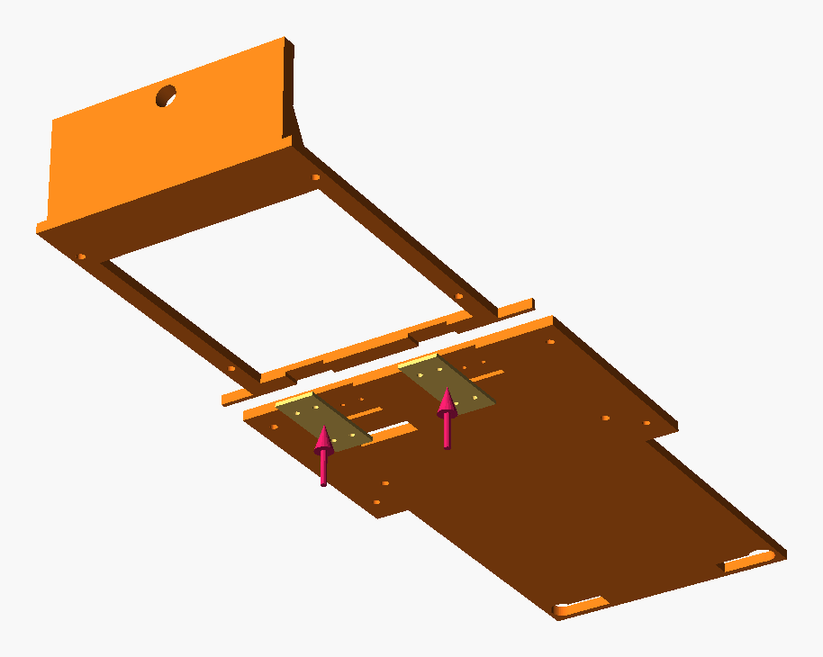

- Turn `bridge_front` and `bridge_back` upside down, push them together and fix two splices across the seam.
- The tall upright at the front, with the hole, holds the chute's front axle.

**Parts:** `bridge_front`, `bridge_back`, `2 × splice`  
**You need:** M2 × 6 or CA glue

### 10. Bed walls and scan bed

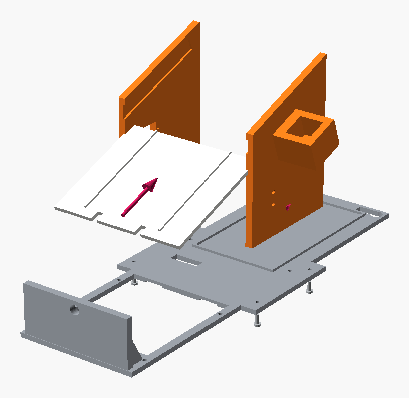

- Stand the two `..._enclosure` bed walls on the bridge's side ears and screw each one from below, two M3 per wall.
- Slide the white bed plate into the grooves on the inside of the walls: low rails up, pin slots at the low front edge.

**Parts:** `bed_side_left_enclosure`, `bed_side_right_enclosure`, `bed_plate (white)`  
**You need:** 4 × M3 × 8

### 11. Tilt bracket, stop pins

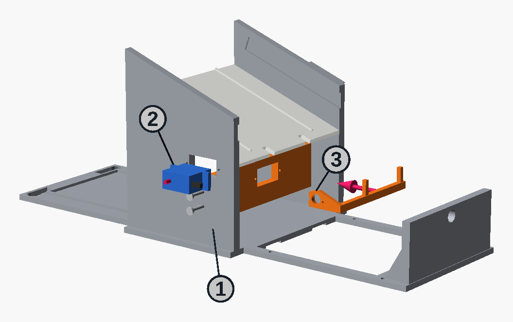

- **(1)** `tilt_bracket` across between the walls under the bed, two M3 through each wall.
- **(2)** Stop-pin servo into the rectangular hole in the left wall from the outside, shaft pointing in. Use the two screws that came with it.
- Centre the servo at 90° before you fit the horn (see the box below).
- **(3)** `pin_rocker`: screw the double-arm horn to its flat plate first (the two horn holes nearest the hub), then push the pair onto the centred servo, pins up, and fit the centre screw through the round hole. Servo at "up": both pins poke up through the slots at the front of the bed. 28° the other way: they drop below the surface.

**Parts:** `tilt_bracket`, `pin_rocker`  
**You need:** 4 × M3 × 8, 1 MG90S (channel 0)

### 12. Lights and camera post

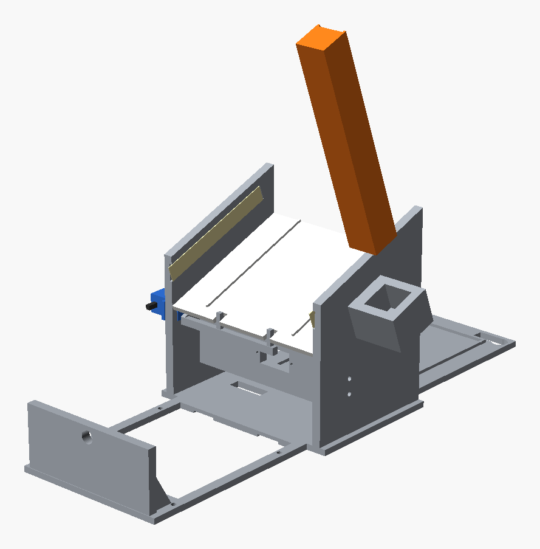

- Stick an LED strip in the groove along the inside of each wall, just above the bed (about 9 cm each). Don't cut the wire between the two pieces if you want to skip soldering: loop it under the bed.
- Push `tower_post` into the square socket on the right wall. The groove on its back is for the camera cable.
- Leave the camera head off for now. The deck can't go on over it (step 18).

**Parts:** `tower_post`  
**You need:** USB LED strip

### 13. Build the chute

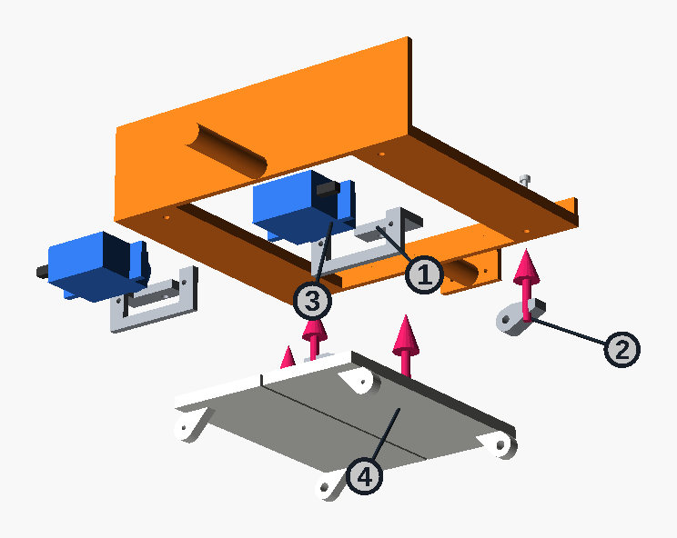

- **(1)** A servo into each `trapdoor_mount` (two screws each). Screw the mounts under the front of the chute floor with M2 from above.
- **(2)** `hinge_lug` and `hinge_lug_left` under the back of the chute floor, the same way.
- **(3)** Centre both servos at 90° before fitting horns.
- **(4)** Trapdoors: the back ear goes on an M3 screw through the hinge lug (that's the hinge pin), the front ear screws to the servo horn. Closed, both doors sit flush with the floor.

**Parts:** `chute`, `trapdoor`, `trapdoor_left`, `trapdoor_mount`, `trapdoor_mount_left`, `hinge_lug`, `hinge_lug_left`  
**You need:** 4 × M2 × 6, 2 × M3 × 12 (hinge pins), 2 MG90S (channels 2, 3)

### 14. Chute into the bridge

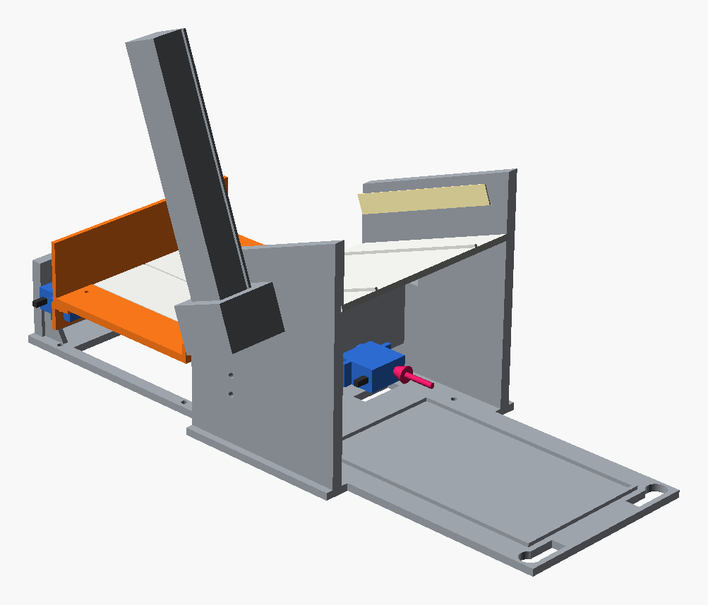

- Push the chute's front axle into the hole in the bridge's front upright.
- Push the tilt servo through the tilt bracket from the back and screw it in. Centre it, then screw its horn to the small plate on the chute's back end.
- Test by hand: level, 25° left, 25° right. Nothing should touch the walls or the bridge.

**You need:** 1 MG90S (channel 1)

### 15. Feeder on the bridge

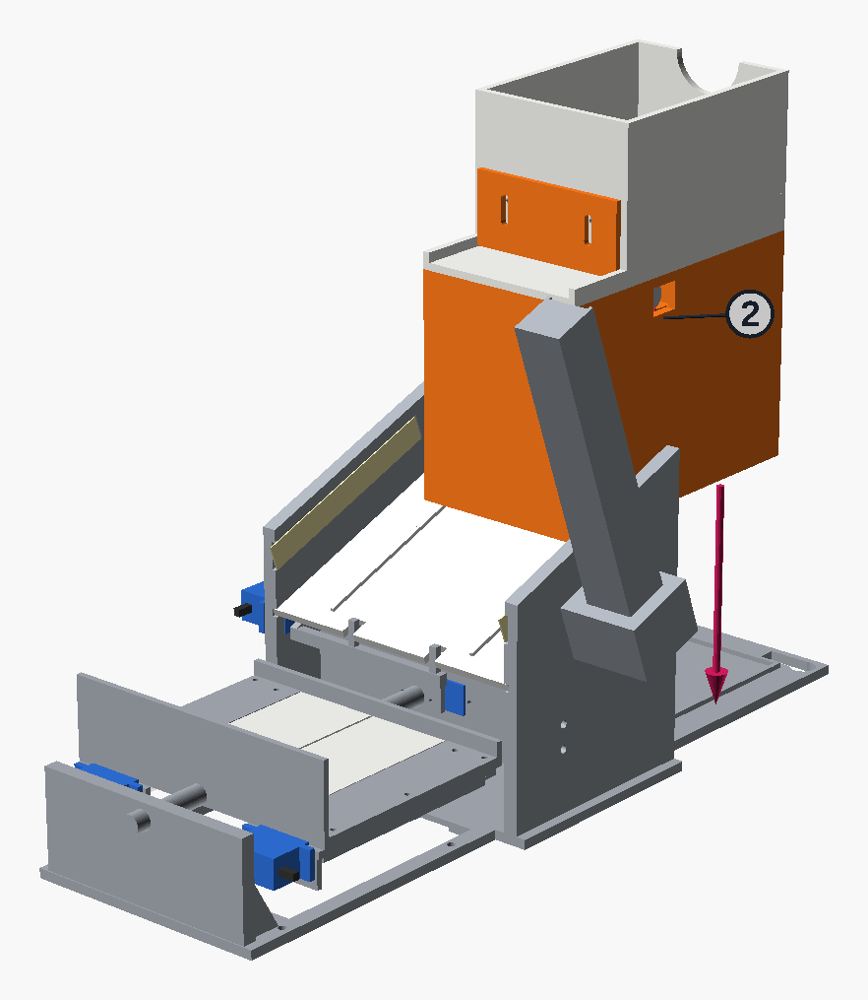

- The feeder is the one from Part 1, on the tall `feeder_stand_mid`: **(2)** N20 motor and roller in the stand, hopper and gate on top.
- **(1)** Set the stand in the low fence on the bridge, behind the bed, with the exit shelf facing the bed.
- Cards leave the shelf and drop onto the top of the bed.

**Parts:** `feeder_stand_mid`, `feeder_hopper`, `feeder_gate`, `feeder_roller`  
**You need:** N20 motor + 2 O-rings

## Into the box

The mechanism goes in, gets wired, and the top closes over it.

### 16. Bridge into the box

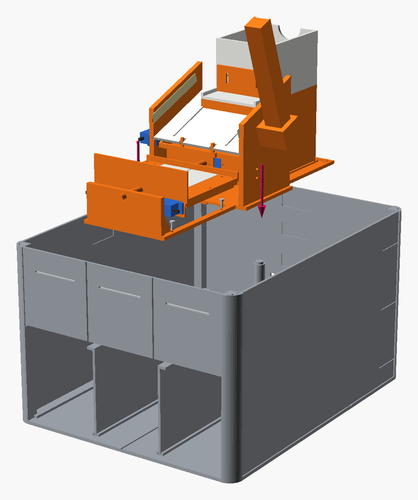

- Lower the whole bridge in from above. The front edge rests on the dividers' flanges, the two leg pegs go through the holes at the back.
- Screw it to the flanges, three M3 per side.
- Now wire everything (see Wiring, below). Run the camera cable up the groove in the camera post.

**You need:** 6 × M3 × 8

### Wiring

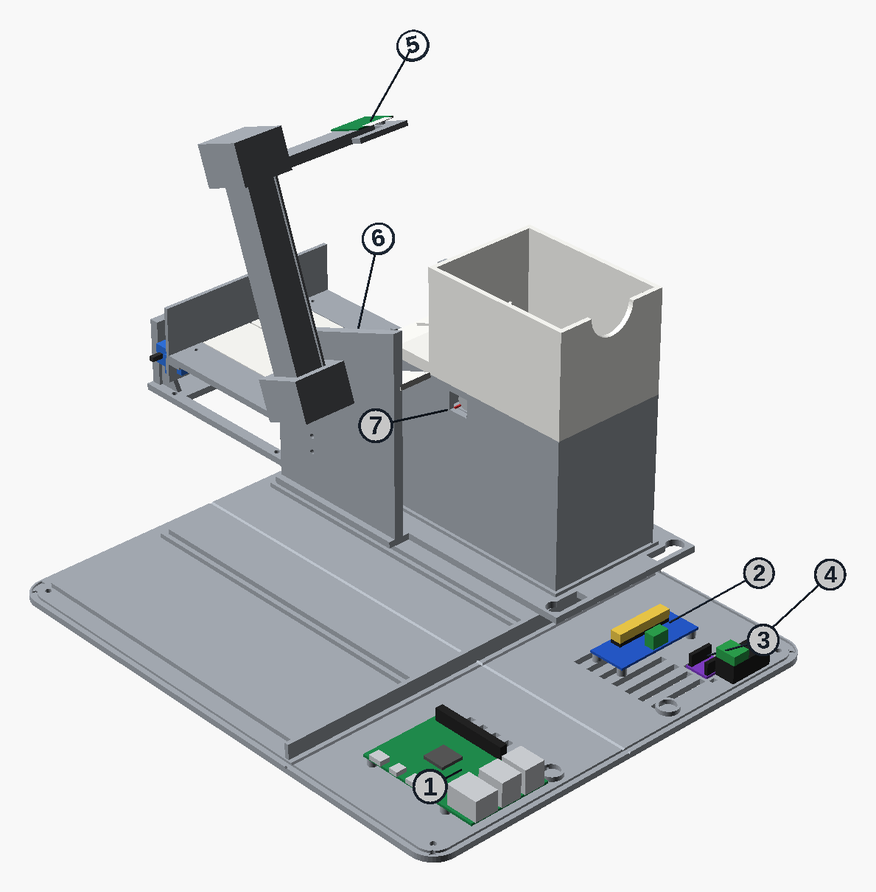

- **(1)** **Raspberry Pi 5**: on the floor. Power from the official 27 W USB-C supply, never from the servo supply.
- **(2)** **PCA9685** servo board: I²C to the Pi, servo power from the 5 V adapter.
- **(3)** **DRV8833** motor driver: two Pi pins, motor power from the 5 V adapter.
- **(4)** **Barrel-jack screw adapter**: the 5 V 4 A adapter's plug goes in here.
- **(5)** **Camera Module 3**: on the camera head, ribbon down the post to the Pi's camera port.
- **(6)** **LED strips**: on the bed walls, USB into the Pi.
- **(7)** **N20 feeder motor**: in the feeder stand, to DRV8833 OUT1 / OUT2.
- The four **MG90S** servos are in steps 11, 13 and 14: stop pins on the left wall, tilt behind the tilt bracket, trapdoors under the chute.

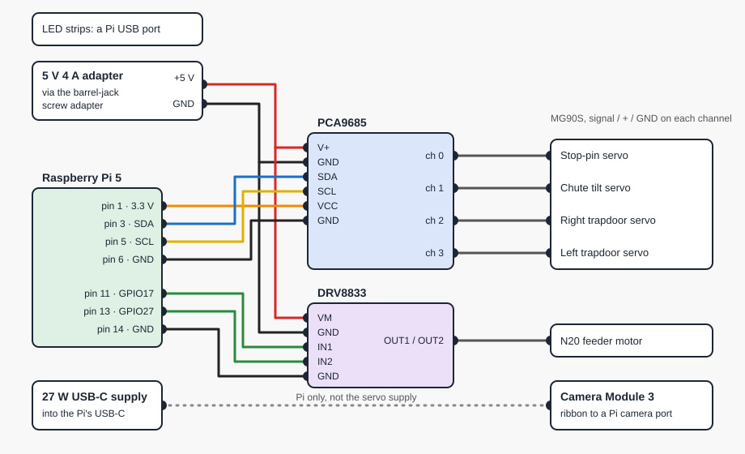

| PCA9685 channel | Servo | Moves |
|---|---|---|
| 0 | Stop pins | up (card stops) / down 28° |
| 1 | Chute tilt | centre / 25° left / 25° right |
| 2 | Right trapdoor | closed / open 90° |
| 3 | Left trapdoor | closed / open 90° |

- **The servo supply must be 5 V.** Check the adapter's label. A 12 V adapter burns an MG90S out in seconds: swap it, or put a 12→5 V buck converter in between.
- **Never power the servos from the Pi's 5 V pin.** Four servos at once will crash the Pi.
- **Join all the grounds**: Pi, PCA9685, DRV8833 and the adapter.
- Turn on I²C (`sudo raspi-config nonint do_i2c 0`); `i2cdetect -y 1` should then show `40`.

### 17. Deck

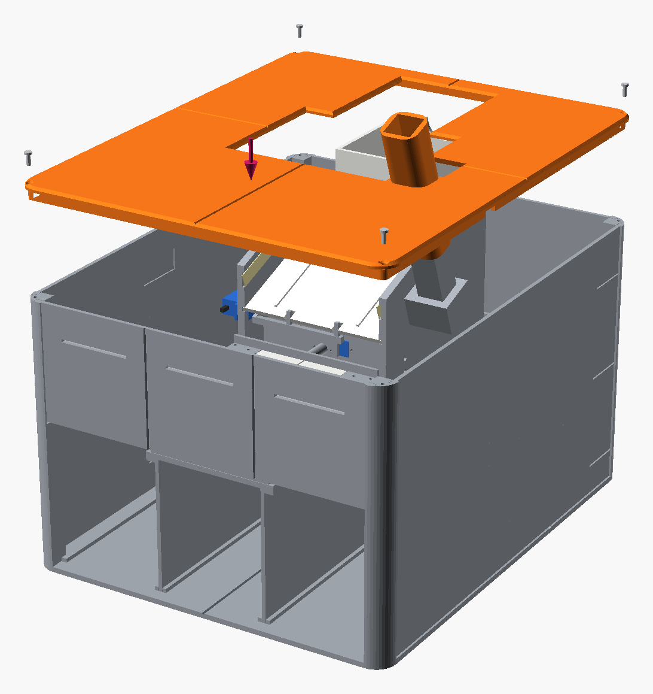

- Slide `post_sleeve` down over the camera post.
- Join `deck_fl` and `deck_fr` with two splices across the middle seam. Leave the two pockets on the front/back seam empty, so the back can lift off for the Pi.
- Lay the front deck on, then the two back halves. They're separate pieces.
- One countersunk M3 into the top of each corner post.

**Parts:** `post_sleeve`, `deck_fl`, `deck_fr`, `deck_bl`, `deck_br`, `2 × splice`  
**You need:** 4 × M3 × 8, countersunk

### 18. Camera, covers, hopper tower

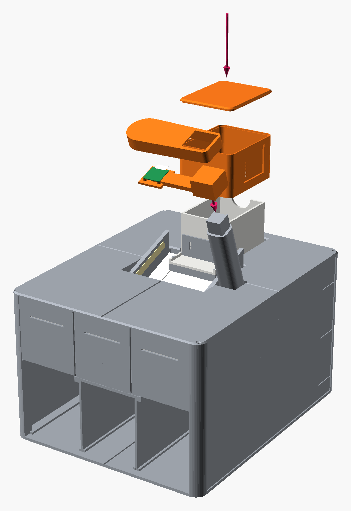

- Screw the Camera Module 3 onto the top of `camera_head`, lens down through the window (4 × M2).
- Push the head onto the top of the camera post and plug the ribbon in.
- `head_cover` over the head and arm.
- `tower` down over the hopper into the well in the deck, then `tower_lid` on top.

**Parts:** `camera_head`, `head_cover`, `tower`, `tower_lid`  
**You need:** 4 × M2 × 6, Camera Module 3

### 19. Drawers in

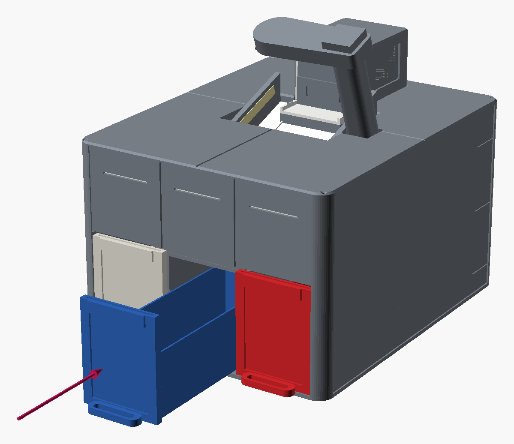

- Print three Card Catalog v1.2 drawers and their top bars from the MakerWorld 3MF.
- A toploader with a card in each front pocket, top bar clipped on.
- Slide them in: left is bin 1, middle bin 2, right bin 3.

**Parts:** `3 × Card Catalog drawer + top`

---

Pictures: `python3 guide/render.py` (needs OpenSCAD), then `python3 guide/build_guide.py`.
