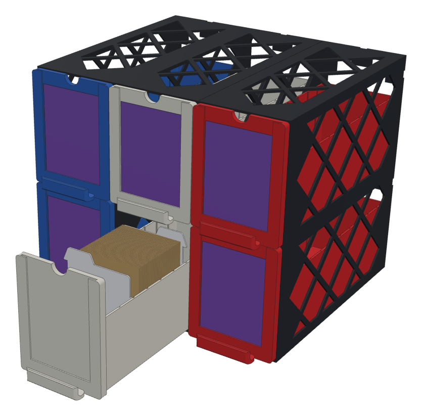
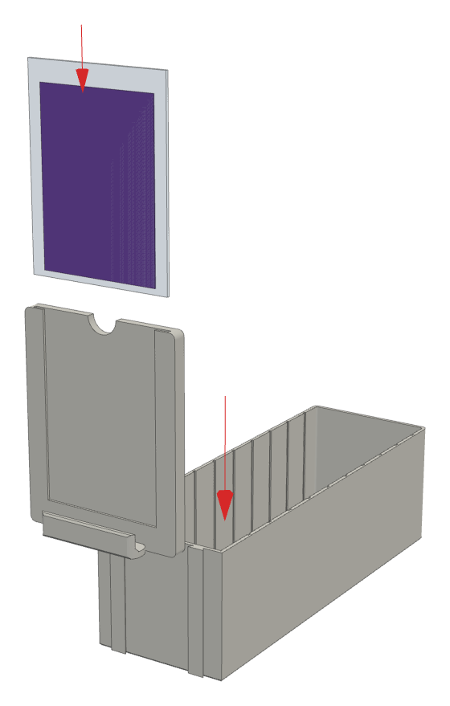
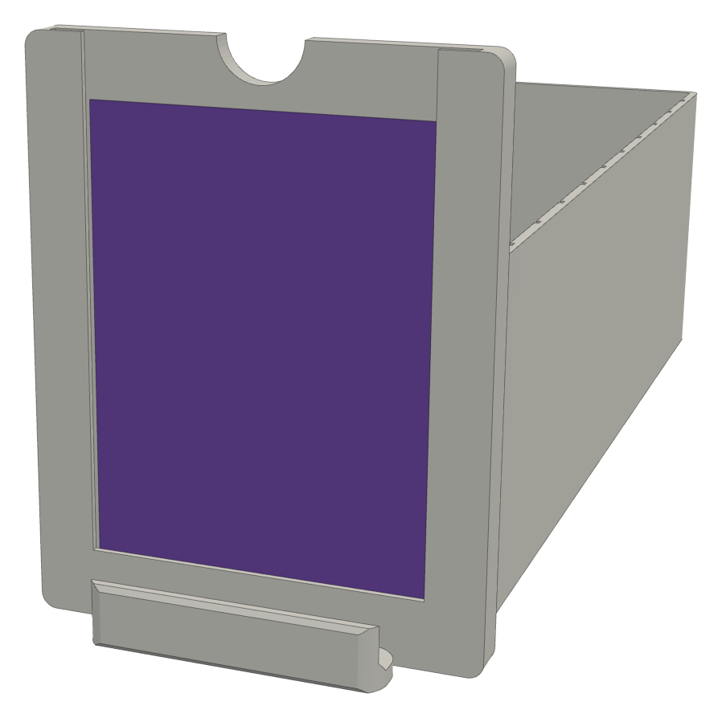
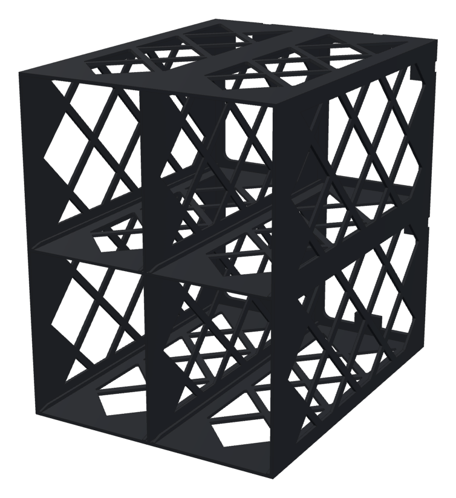
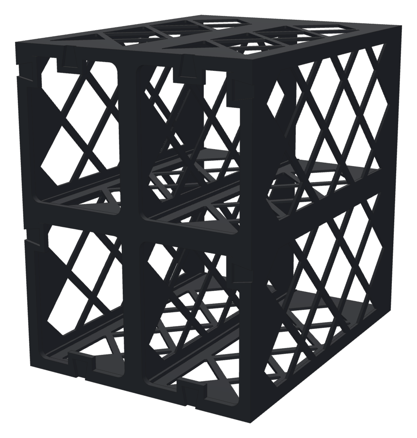
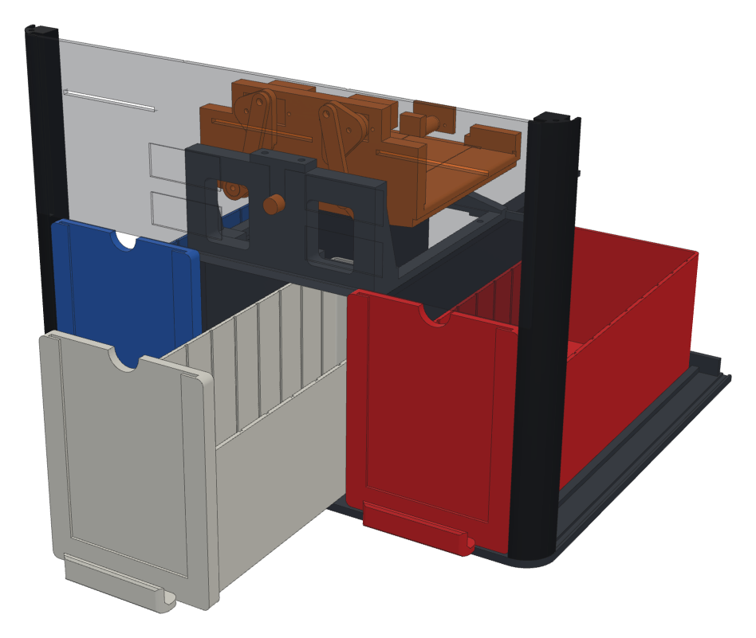

# Bins and the card organizer

`bins.scad`. Three **bins** sit in the bays at the front of the sorter, one under each output:

| Bay | Bin | Gets the cards that |
|---|---|---|
| left | bin 1 | slide off the left end of the tilting tray |
| middle | bin 2 | drop through the trapdoors |
| right | bin 3 | slide off the right end of the tray |

A full bin slides out of the front of the sorter and straight into a cubby of the
**organizer**, a stackable cabinet, so sorted cards never get re-boxed. Put an empty bin back
in the sorter and carry on.

These are our own parts. They keep the outside size the sorter's dock was built around
(`enclosure.scad`, the `dr_*` block, measured from the Card Catalog drawer in October), so they
fit the enclosure you've printed without changing anything there.

## The bin

A bin is two parts: the **tray**, and a **front plate** that slides down onto it and lifts off.

| | mm |
|---|---|
| Tray | 76 wide × 70 tall × 223.5 long, with its own 2 mm front wall (72 × 219.5 inside) |
| Front plate | 86 wide × 109 tall × 7.5 thick |
| Whole bin | 231 long (plate front to tray back), 244 with the pull |

- **Removable front plate:** two dovetail rails run up the tray's front wall. The plate's
  grooves slide down over them until the plate rests on the rail tops. Lift it straight up to
  take it off. The dovetails hold it when you pull the bin out by its handle. The tray has its
  own front wall, so it holds cards with the plate off. Swap plates between bins, or print
  plates in another colour.
- **Showcase card:** the plate has a pocket open at the top for a card in a standard 3 × 4
  inch toploader (76.2 × 101.6). Drop it in from above. The card shows through a 64 mm wide
  window, and the notch at the top lets you pinch the toploader and pull it out. You can also
  write on one of the blank white cards (plate 4) and drop that in. The pocket is sized for a
  toploader: a sleeved card on its own will be loose in it.
- **In the sorter** cards land flat, long side front to back. About 220 fit before the pile
  reaches the rim. Empty the bin before it gets there.
- **In the organizer** stand the cards on end, faces to the front, and flip through them like
  an index. Standing, a bin holds about 700 cards. The tops stick up 20 mm above the rim, so
  they're easy to grab.
- **Divider grooves** run up both inside walls every 20 mm. A divider drops into any pair.
  Take the dividers out before a bin goes back in the sorter: they stand taller than the rim.
- **Finger pull** along the bottom of the plate: hook your fingertips into the cup and pull.

## The organizer

Units of cubbies, one bin each. The plates sit side by side 0.5 mm apart, the same as in the
sorter, so a row of three bins looks the same in either place.

| Unit | Cubbies | Outside (w × h × d) |
|---|---|---|
| `organizer_2x2` | 2 wide, 2 high | 173 × 222 × 229.5 |
| `organizer_1x2` | 1 wide, 2 high | 86.5 × 222 × 229.5 |
| `organizer_2x1` | 2 wide, 1 high | 173 × 111 × 229.5 |
| `organizer_1x1` | 1 | 86.5 × 111 × 229.5 |

A 3-wide unit would be 259.5 mm and doesn't fit the A1, so 3 wide is a 2x2 next to a 1x2. That
makes 6 cubbies: the sorter's three bins and room for three more. Add units beside it or on
top whenever you need more.

- Thin walls with diamond windows, about a third of the plastic of a solid box. The bin rides on
  the solid strips along each cubby floor, between two low guide curbs.
- A bin goes in until the back of its tray stops on the frame at the back. The plate then sits
  half a millimetre in front of the cabinet. There's a hole in the back of every cubby, so you
  can push a bin out from behind.
- **Joining units:** bow-tie `key`s tap into the pockets on the back face, across the seam. Use
  one per row for units side by side, and one per column for a unit stacked on top. A 2x2 + 1x2
  side by side takes 2 keys. The project has 6.

## Printing

Open **`bambu/MTG_Sorter_Bins_And_Organizer.3mf`** with **File → Open Project**. Don't drag the
STLs in. If Bambu Studio asks whether to load the project as a single object, say **No**. It
has the same A1 settings as the enclosure project.

| Plate | What's on it | Colour | About | Note |
|---|---|---|---|---|
| 1 | 3 × `tray` | black (or any) | 400 g, 11 h | standing on their floors, no supports |
| 2 | 3 × `plate` + 6 × `key` | black (or any) | 140 g, 6 h | the plates stand on their bottom edges, with a brim |
| 3 | 6 dividers (tabs left, middle, right) | **white** | 60 g, 2 h | white takes pencil or marker |
| 4 | 3 blank showcase cards | **white** | 25 g, 1 h | optional: write a name and drop it in the plate |
| 5 | `organizer_2x2` | black | 400 g, 13 h | stands on its back, 230 mm tall, with a brim |
| 6 | `organizer_1x2` | black | 240 g, 8 h | the same |

Weights are the parts' volumes (the walls are thin enough to print solid), and times are
guesses: Bambu Studio's estimate is the real one. Everything is about **1.2 kg**, more than one
spool. Print the trays and plates first (plates 1 and 2). They're what the sorter needs. Then the organizer when you want
it. **Fit check:** before plate 5, slide one bin into each bay of the sorter. It should run
between the curbs with a little side play, and the plate should end flush with the fascia.

To change sizes, edit the numbers at the top of `bins.scad` and run
`sh export_enclosure.sh` (it exports the `bins_*` STLs too), then
`python3 bambu/make_small_projects.py MTG_Sorter_Bins_And_Organizer.3mf`.
`python3 guide/bins/render.py` redraws the pictures.

## Clearances in the sorter

`clash_bins.scad` checks it: the enclosure and the chute v3 mechanism intersected with the three
bins in the dock. The result is empty, so nothing touches a bin, with the tray level and tipped 25°
each way, and the trapdoors shut and open. The nearest things above a bin are the divider
flanges and the bridge, about 30 mm above the rim. Lifting the bins 30 mm in the same check makes
them hit. Run it with a recent OpenSCAD (`--backend=manifold` takes seconds; 2021.01 takes many
minutes):

    openscad --backend=manifold -o clash.stl -D show_tilt=25 -D show_doors_open=true clash_bins.scad
