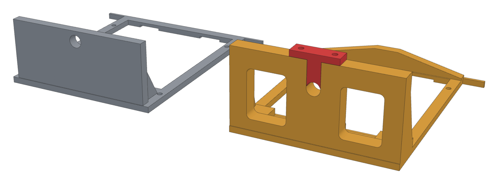
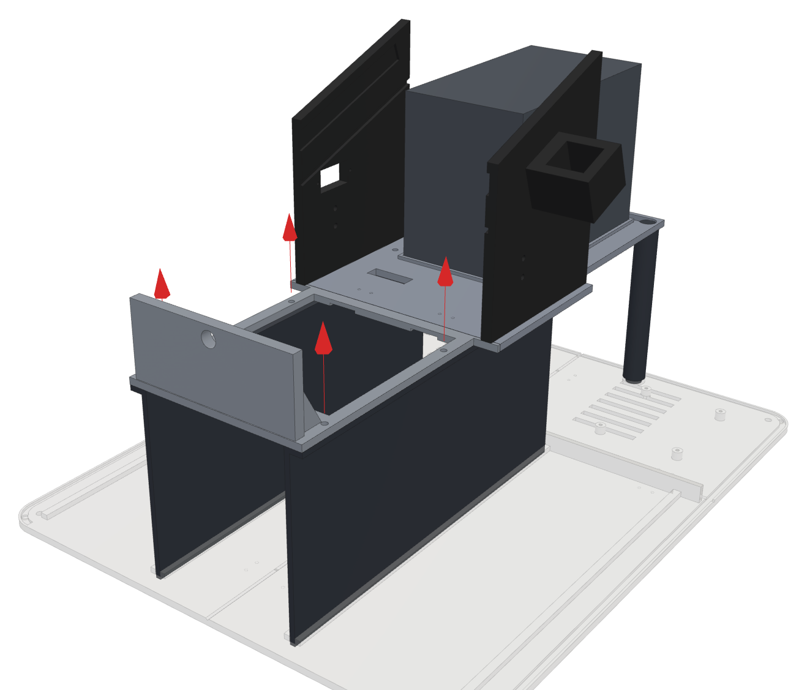
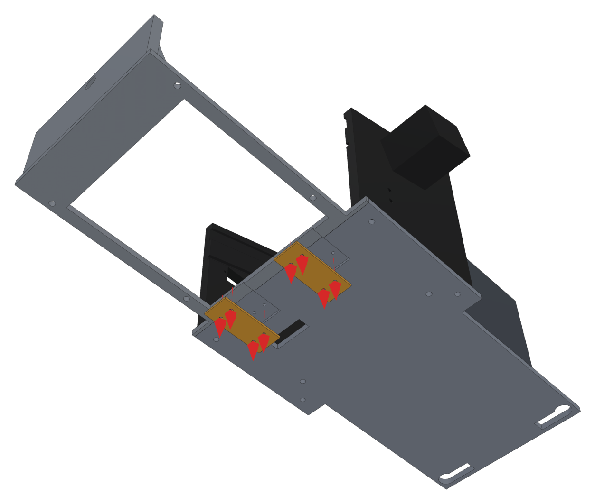
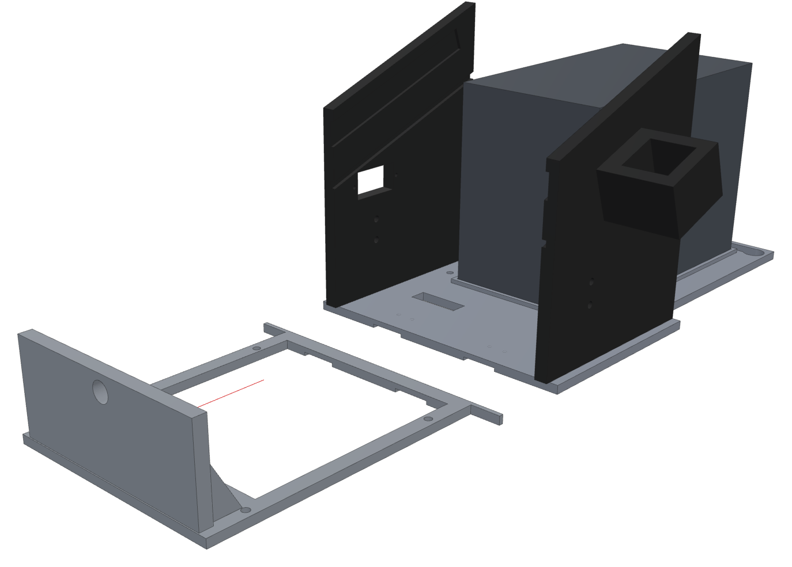
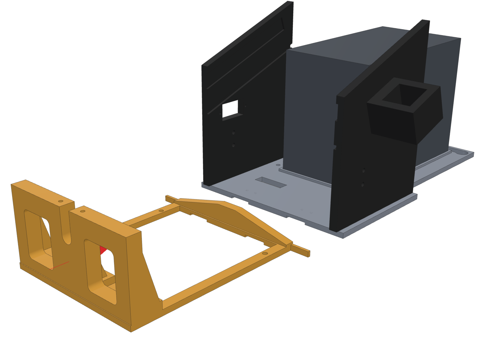
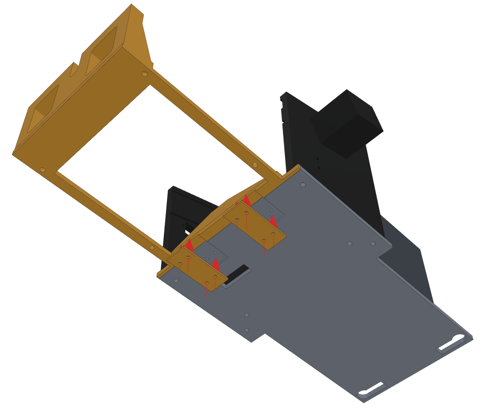
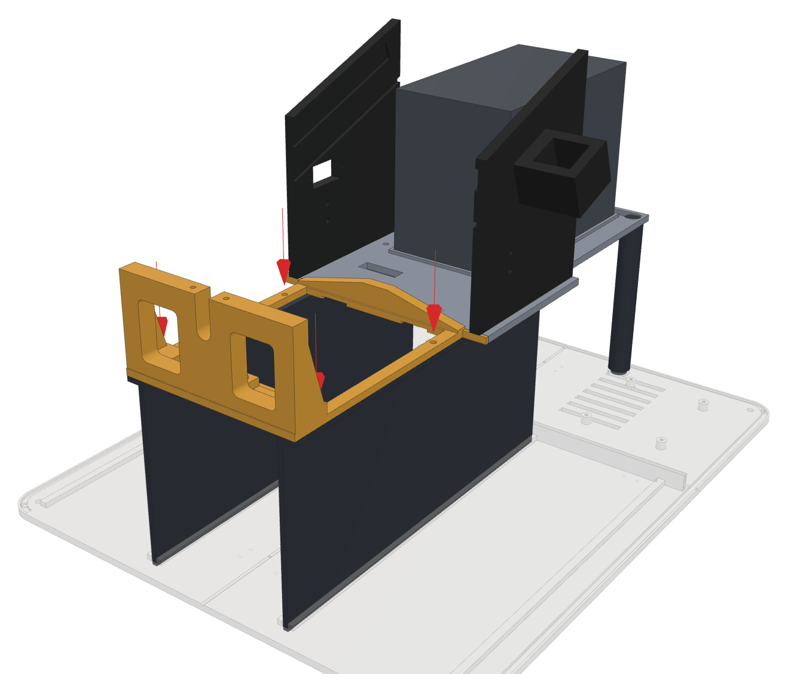
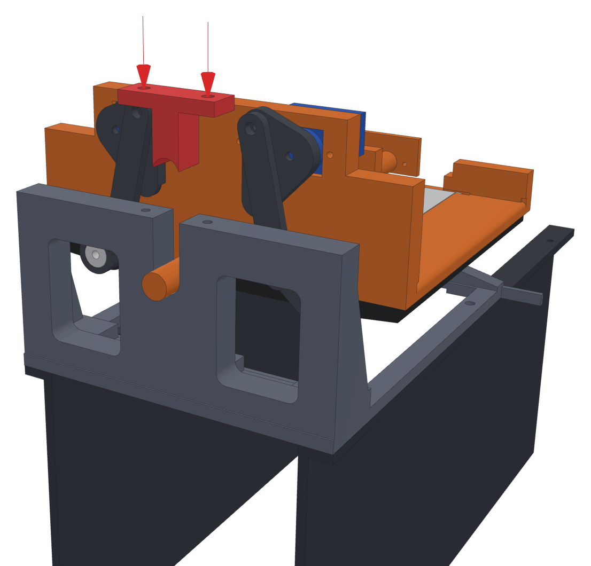

# Front bridge v3: swap guide

Swapping the old front bridge for the new one, in the box. A single-file version with the pictures inside: [`bridge_v3_guide.html`](bridge_v3_guide.html). The rest of the chute is in [CHUTE_V3.md](CHUTE_V3.md).

## You need

- The new `enc_bridge_front` and the red `enc_bridge_cap` (plate 2 of `MTG_Sorter_Chute_v3.3mf`).
- The 4 screws and 2 splices from the old front bridge, with their 8 small screws. Two spare splices are on plate 2 too, in case yours were glued.
- 2 × M3 × 12 for the cap.
- A **stubby screwdriver** (under about 9 cm) that fits the splice screws, for working under the bridge through the middle drawer's opening.

## Old front bridge out

You don't need to take the whole mechanism out of the box. The back half of the bridge, the bed walls, the feeder and the tilt servo all stay where they are.

### 1. What's changing

- Left: the old front bridge, a thin frame with the tray's axle in a 6 mm plate.
- Right: the new one. The 10 mm front wall has a **slot** the axle drops into, and the red **cap** screws on top to close it.
- The new one has the same footprint and screw holes, so it fits exactly where the old one was.

### 2. Make room, then take out 4 screws

- Lift off the two **front deck tiles**, and pull out **all three drawers**.
- Unscrew the tilt servo's horn from the tray's back plate and lift the old tray out (if it isn't out already).
- Take out the **4 screws** that hold the front bridge down onto the tops of the two dividers, two per side (the arrows).
- Leave the two screws further back alone. They hold the back half.

**You need:** screwdriver

### 3. Splice screws, from underneath

- This picture looks **up** at the underside. Two small plates (splices) join the front and back halves under the seam, 4 small screws each.
- Reach in through the empty **middle drawer opening** with the stubby screwdriver. The splices are about 13 cm in, either side of the middle.
- Take out all 8 screws and keep the splices.
- Glued instead of screwed? Pry the front half off and use the two spare splices from plate 2 later.

**You need:** stubby screwdriver

### 4. Slide it forward and lift it out

- The bed walls sit about 2 mm over the front bridge's back corners. So slide the front bridge **forward** about 3 mm first, then lift it straight up and out.
- If a wire runs through the old opening, unhook it so it doesn't snag.

## New front bridge in

### 5. Lower it in and slide it back

- Hold the new bridge with its **tall wall at the front** (towards the drawers) and the slot at the top.
- Lower it onto the divider tops about 3 mm in front of where it goes, then slide it **back** until it meets the back half. Its back corners go under the bed walls.
- The 4 screw holes in its sides should now sit over the holes in the divider tops.

**Parts:** `enc_bridge_front`

### 6. Splices back on, from underneath

- Looking up again. Hold each splice up into its shallow pocket across the seam and drive its 4 small screws in.
- Snug, not tight: they go into plastic.

**Parts:** `2 × splice`  
**You need:** 8 splice screws, stubby screwdriver

### 7. Screw it to the dividers

- Put the 4 screws back down through the side strips into the divider tops.
- Push the drawers back in. They should slide all the way home without touching anything.
- Press on the top of the front wall: it shouldn't move at all.

**You need:** 4 screws from the old bridge

### 8. Tray in, cap on

- Do this when the new tray is built (steps 2 to 4 of the chute guide).
- Centre the tilt servo (**Chute** 90 on the Machine page). Lower the tray in: its back plate goes onto the tilt servo's horn, and its front axle drops down into the slot.
- Push the red cap down into the slot on top of the axle and screw it on with 2 × M3 × 12.
- With the servo let go, the tray should rock left and right freely. If it's stiff, loosen the cap screws half a turn.
- Put the front deck tiles back on.

**Parts:** `enc_bridge_cap`  
**You need:** 2 × M3 × 12

