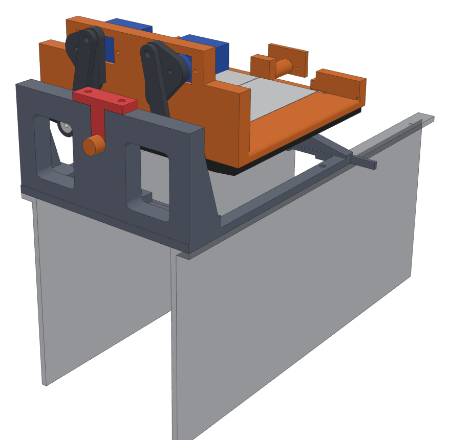
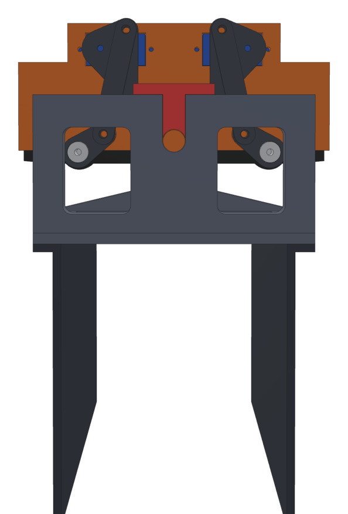
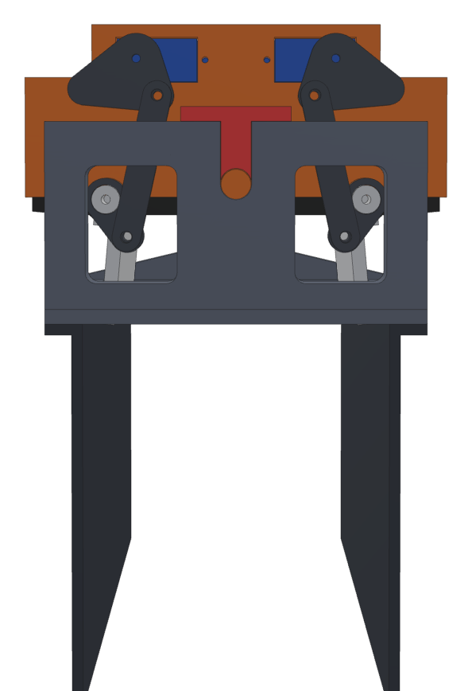
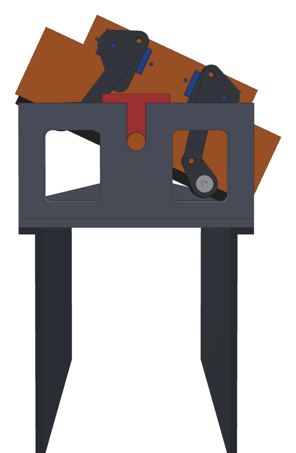
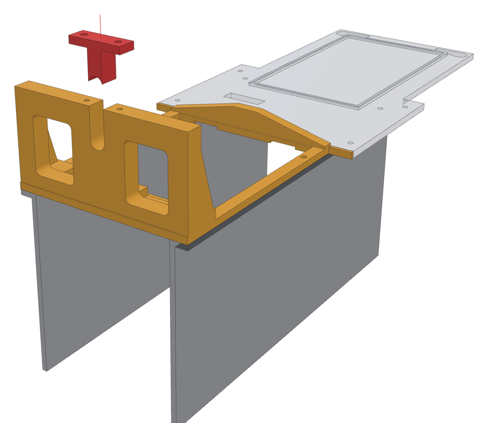
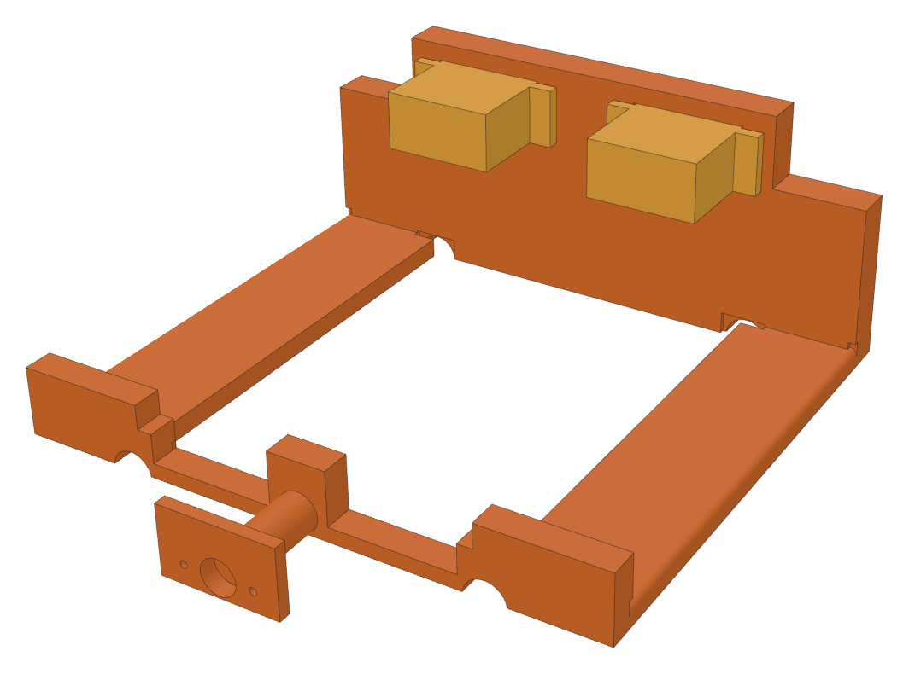
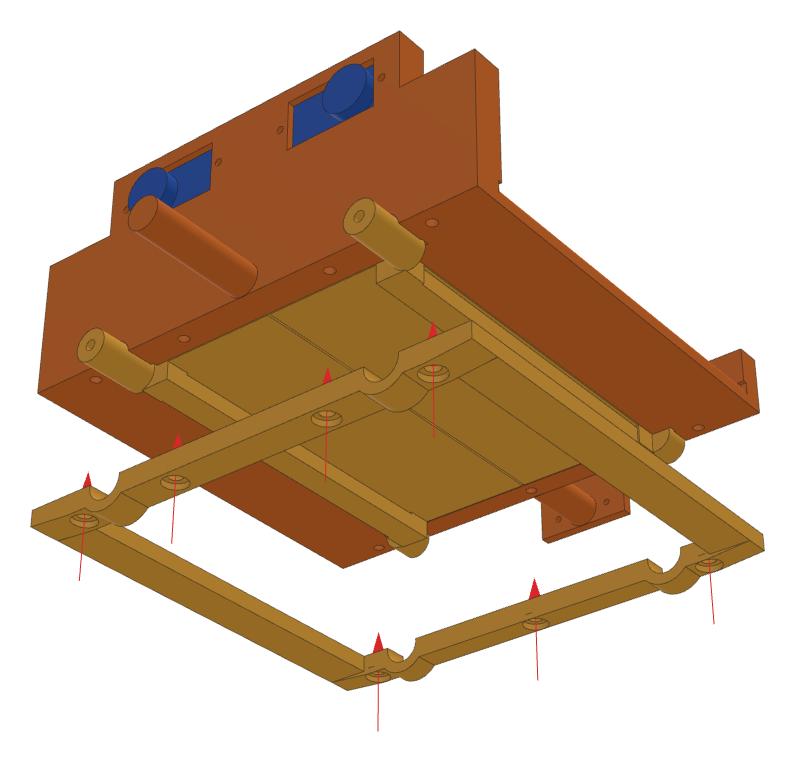
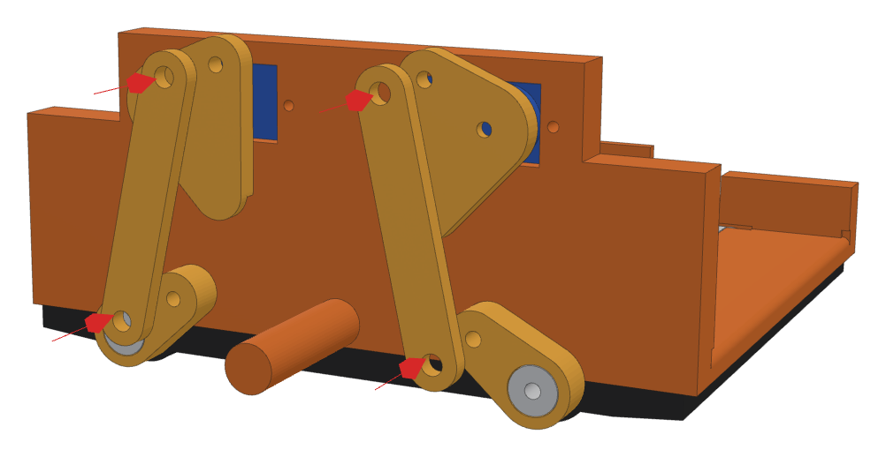
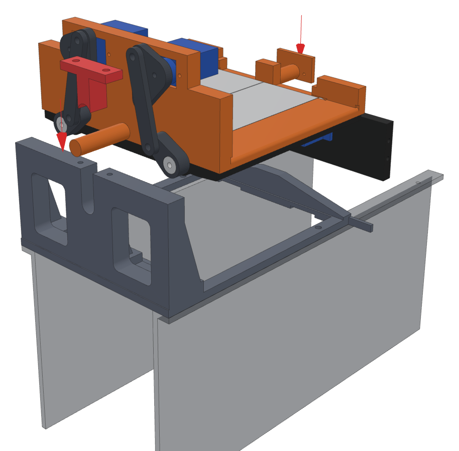

# Chute v3 and front bridge v3

A new tray, trapdoors and front bridge, built so they can't break the way the v2 ones did.

| Problem | Cause | v3 fix |
|---|---|---|
| The door carrier snapped and a horn came off | A thin 2.5 mm tab plate held the servo, and each door hung on its servo's shaft | Each door turns on **two round journals** clamped between the tray and a screwed-on **hinge frame**. The servos sit in pockets in an **8 mm front wall** and drive the doors through a crank and a link, so a servo never holds a door up |
| Cards caught on screw heads | The carriers were screwed down through the tray floor | **No screws in the floor at all.** The card only ever touches the bare, flat print |
| The doors only opened about 67° | ServoKit's default pulses give an MG90S only about 135° of travel | With **Wider servo travel** on, the link turns each door a full **95°** |
| Hot servos at full tilt | The old door servos hung under the tray and hit `bridge_front` at 25° | Nothing hangs below the tray. Checked in CAD at ±25° with the doors shut and open, and with the stop gate swinging down |
| The front bridge was flimsy | A 4 mm ring round a big hole, the tray's axle in a 6 mm plate on two 3 mm gussets | A **10 mm bearing wall** with gussets, a 10 mm shelf behind it (an L beam) and an arched beam at the back. The tray's axle **drops into a slot** and a screw-on cap closes it |

| Waiting | Bin 2: doors open | Bin 3: tipped right |
|---|---|---|
|  |  |  |

A single-file version with the pictures inside: [`chute_v3_guide.html`](chute_v3_guide.html).

## Print

Open **`bambu/MTG_Sorter_Chute_v3.3mf`** with **File > Open Project** (not Import). The settings are already applied. All black, no supports. Times and weights are estimates until it's sliced.

| Plate | Parts | Filament | Roughly |
|---|---|---|---|
| 1 | chute tray, hinge frame | black | about 4 h, 60 g |
| 2 | front bridge, bearing cap, both doors, both door cranks, both servo cranks, 2 links | black | about 6 h, 90 g |

You can stop using: the old `chute`, both `trapdoor`s, both `door_carrier`s, the `hinge_pin`s and the old `bridge_front`. Everything else (bridge_back, bed walls, tilt bracket, tilt servo, feeder, wiring) stays as it is.

## Bits you need

- **7 × M3 × 12** self-tapping: hinge frame, from below.
- **2 × M3 × 10** with washers: door cranks onto the door journals.
- **4 × M3 × 8**: the link pins (two per link).
- **2 × M3 × 12**: the bearing cap.
- From the servo bags: 4 tab screws, 2 **single-arm** horns and their centre screws.
- The 4 divider screws and 2 splices from the old front bridge.

## The front bridge

Take the old tray out first: unscrew the tilt servo's horn from its back plate and lift it away.

### 1. Swap the front bridge

- Unscrew the old `bridge_front` from the dividers and the two splices, and lift it out.
- Set the new one on the dividers with the **tall wall at the front**, and put the same screws back through it into the divider tops and the splices.
- Keep the red **cap** and its 2 screws for step 5.

**Parts:** `enc_bridge_front`, `enc_bridge_cap`  
**You need:** 4 divider screws, 2 splices

## The tray

Build it on the bench.

### 2. Door servos into the front wall

- From **inside** the tray, push each MG90S into its pocket in the front wall, shaft end first, so the shaft comes out on the front.
- The bodies point **in**, towards the middle. Screw each one through its two tabs into the wall.
- Run the wires over the top of the wall and out to the side. Leave a loop of slack: the tray tips 25° each way.

**Parts:** `bed_chute_chute3`  
**You need:** 2 × MG90S, 4 tab screws

### 3. Doors and hinge frame

- Turn the tray upside down.
- Lay each door in, **smooth face down**, so its round journals sit in the half-round notches at the front and back. The long journal goes out through the front wall. The two doors are mirror images, so each only fits its own side.
- Put the hinge frame on top, its half-round notches over the journals, and drive the 7 screws in.
- Turn it over and swing each door by hand. It should flop open and shut freely. If one binds, loosen the two screws nearest it a little.

**Parts:** `bed_chute_door3`, `bed_chute_door3_left`, `bed_chute_hinge_frame3`  
**You need:** 7 × M3 × 12

### 4. Cranks and links

- Slide a **door crank** onto the D-shaped end of each door's front journal and screw it on with an M3 × 10 and a washer. Tight.
- Press a single-arm horn into the pocket on the back of each **servo crank**, its arm in the slot.
- Screw a **link** onto each door crank's pin hole with an M3 × 8. Tighten it until it touches, then back it off a quarter turn so the link turns freely.
- Plug the door servos in and press **Closed** for both on the Machine page (with **Wider servo travel** on). Hold each door shut, put the servo crank's pin hole over the link's top hole, and push the crank onto the servo shaft at the nearest spline tooth. Fit the horn's centre screw, then the second M3 × 8 through the link.

**Parts:** `bed_chute_door_crank3`, `bed_chute_door_crank3_left`, `bed_chute_servo_crank3`, `bed_chute_servo_crank3_left`, `bed_chute_door_link3 ×2`  
**You need:** 2 × M3 × 10 + washers, 4 × M3 × 8, 2 single-arm horns

## Into the machine

### 5. Drop the tray in

- Set **Chute** to 90 on the Machine page so the tilt servo's horn is level.
- Lower the tray in: the back plate goes onto the tilt servo's horn (same screws as before) and the front axle drops down into the **slot** in the bridge wall.
- Put the red cap into the slot on top of the axle and screw it down with the 2 × M3 × 12.
- The tray should rock left and right freely with the servo let go.

**You need:** 2 × M3 × 12, tilt horn screws

## Servo angles (Machine page)

| Setting | Value | Why |
|---|---|---|
| Wider servo travel | **on** | The doors need the full 95°. Without it they only open about 70° |
| Chute | centre 90, left **65**, right **115** | 25° each way. Clear of the bridge and the stop gate at 25° (CAD), touches the bridge at about 28° |
| Right door | closed **about 40**, open **closed + 95** | Find closed with the slider (see below), then open is 95 more |
| Left door | closed **about 140**, open **closed − 95** | The mirror image: its servo turns the other way |
| Pins | as you have them |  |

**Finding closed:** with the door shut, nudge the door's slider a degree at a time until the door is held flat against its stop with no buzz, then back off one degree and press **Save closed**. Then set open (95 further) and **Save open**. Press Closed / Open a few times to check.

## If something's off

| What you see | Try |
|---|---|
| A door's servo buzzes or gets warm when shut | Closed is pushing the door against its stop. Move closed 2–3 towards open and Save. The doors now **keep holding** after a move (they'd sag open if let go), so they must not push |
| A door opens the wrong way | Swap that door's closed and open numbers round the other side of closed (closed − 95 instead of + 95) |
| A door doesn't open fully | Check Wider servo travel is on, then add a few degrees to open |
| The tray rubs the bridge at full tilt | Bring left/right 2–3 back towards 90 and Save |
| A link is stiff | Back its screws off another quarter turn |

---

CAD: `bed_chute.scad` (CHUTE v3 section) and `enclosure.scad` (`bridge_front3`, `bridge_cap3`). Pictures: `python3 guide/v3/render.py`, then `python3 guide/v3/build.py`.
