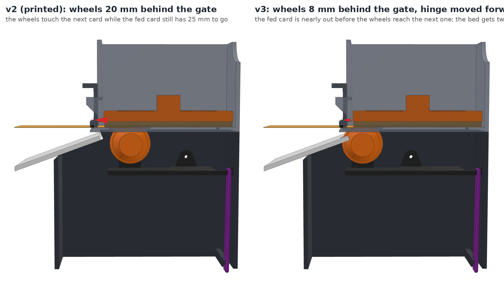
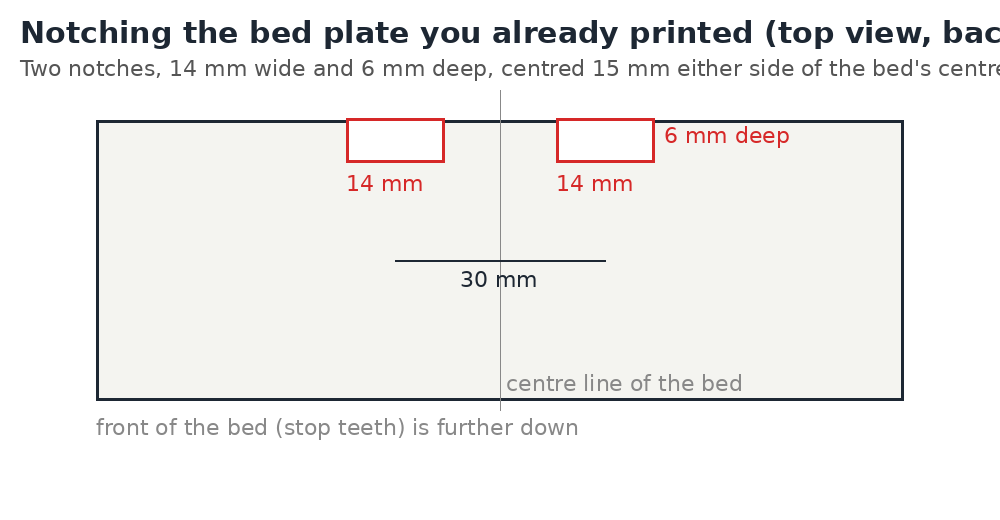

# Feeder v3: wheels at the gate

Reprint of three feeder parts and the scan bed plate, after watching the v2 feeder on the Pi
camera frame by frame (2026-11-05). Print file: `bambu/MTG_Sorter_Feeder_v3.3mf`.

## What was wrong with v2

The two O-ring wheels sat 20 mm behind the hopper's front wall. They can only push a card while
its tail is still over them, so:

- A timed push (the old *Feed one card*) left every card hanging with 20–30 mm still in the
  slot, until the next push dragged it out together with the card behind it (0, 1 or 3 cards per
  push, never reliably one).
- The camera-watched feed (PR #67/#68) fixes that by running the motor until the card lands, but
  the wheels touch the **next** card as soon as the fed card's tail passes them, so it comes out
  20–35 mm behind the first. There is only about 19 mm between the slot and a card resting on
  the stop teeth, so the next card lies on the landed one and pins it: pins down, doors open,
  and the card stays. PR #69 backs the wheels off after each landing, which helps; v3 makes the
  overlap small to begin with.
- Grip depended on the stack's weight: the arm's hard stop carries the rubber band's pull, and
  the band's lever ratio to the wheels was only 29:42.

## What changes

| | v2 | v3 |
|---|---|---|
| wheels behind the front wall (`roller_y`) | 20 mm | 8 mm |
| arm hinge (`pivot`) | y 62 | y 44 (band lever 47:36 at the wheels, about twice the push) |
| hopper floor slots | y 6–34 | y −6–22 (stop 2 mm short of the floor's front edge) |
| stand | hinge holes and motor slot at the v2 places | moved with the arm |
| scan bed plate | plain back edge | two notches, 14 × 6 mm, at x = ±15, for the wheels |

The roller, gate, weight plate, stop gate and gate bearing are unchanged: keep the ones you
have. 8 mm is as close as the wheel gets to the gate without hitting the gate's foot; the
wheels now reach over the bed's back edge, hence the notches (checked in CAD: nothing touches).

## Printing

`bambu/MTG_Sorter_Feeder_v3.3mf`, same settings as the v2 file:

| plate | parts | notes |
|---|---|---|
| 1 | feeder stand v3 | black, brim |
| 2 | feeder hopper v3 | black, brim |
| 3 | feeder arm v3 | black |
| 4 | scan bed plate v3 | **white**, or notch the plate you have (below) |
| 5 | roller, gate, weight, stop gate, gate bearing | unchanged, only for a fresh build |

### Notching the bed plate you already printed

Instead of printing plate 4, cut two notches in the back edge (the edge under the hopper) of the
white bed plate: 14 mm wide, 6 mm deep, centred 15 mm either side of the bed's centre line.
A fine saw or a hot knife works; the notches sit under the hopper floor and the card never
touches them.

## Assembly

The same as v2 (`MECHANISM_V2.md`, feeder steps): motor into the arm, roller on the shaft,
arm into the stand from above, two M3 hinge screws through the stand walls (the holes are now
44 mm from the front wall), rubber band from the arm's tail under the stand's bar, hopper on
its pegs, gate on the front wall. Set the gate so one card slides under it and two don't.
The feeder's *Feed one card* on the Machine page watches the camera; the landing zone and
back-off are in `mtgscanner/feed_watch.py`.

## Changed files

`feeder.scad` (`roller_y`, `pivot`, arm plate, floor slots), `bed_chute.scad` (`wheel_notch`),
`stl/feeder_stand_mid.stl`, `stl/feeder_arm.stl`, `stl/feeder_hopper.stl`,
`stl/bed_chute_bed_plate.stl`, `bambu/make_small_projects.py` (new project, and it takes a
file name to build just one).
