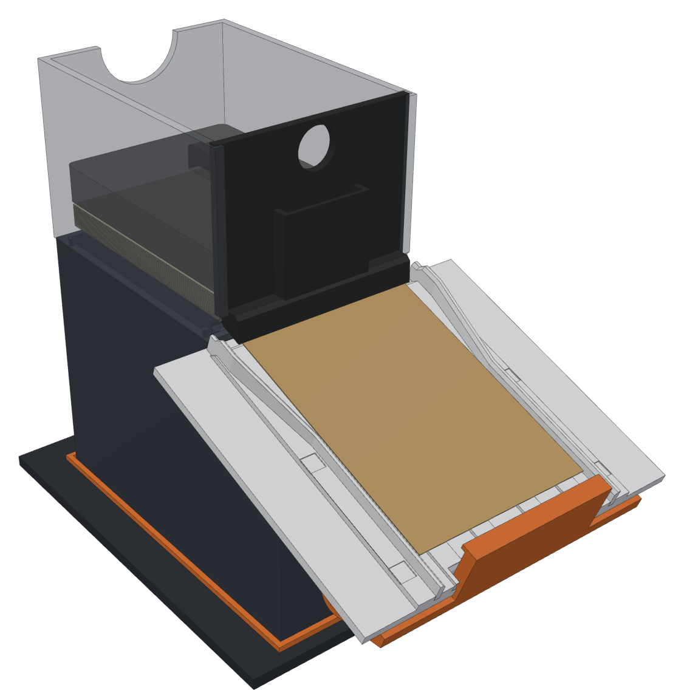
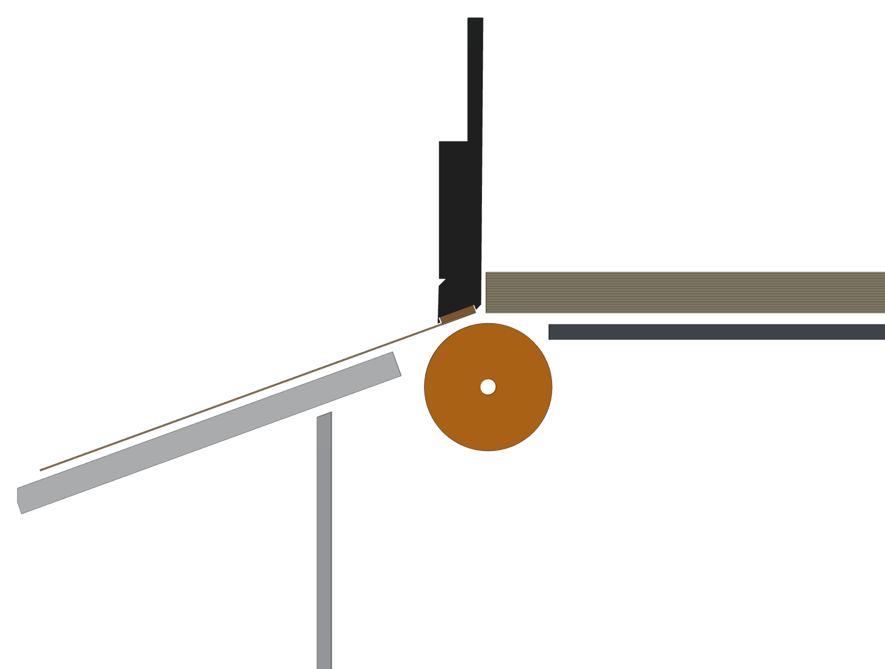
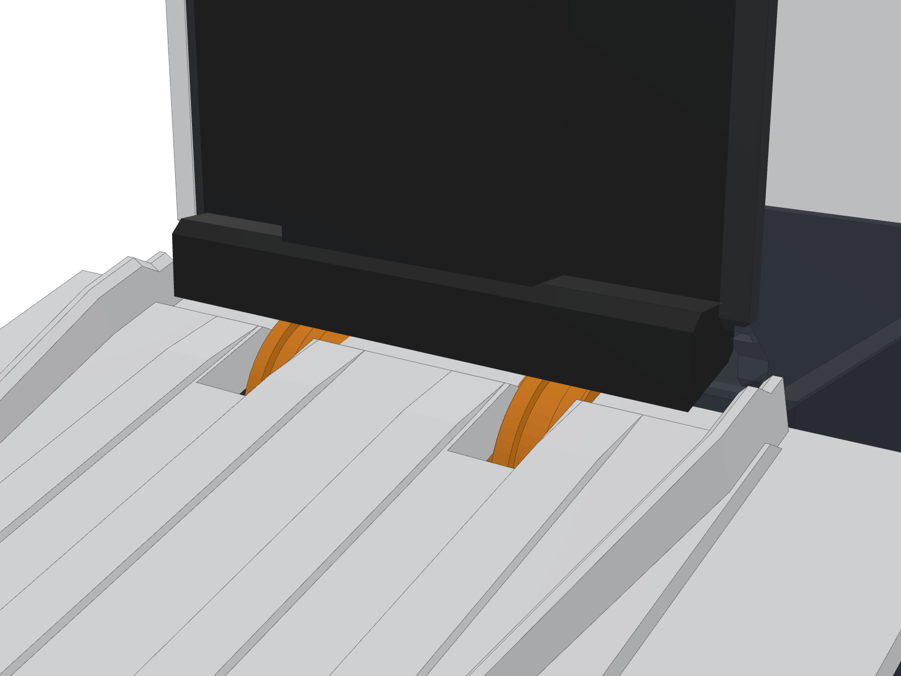
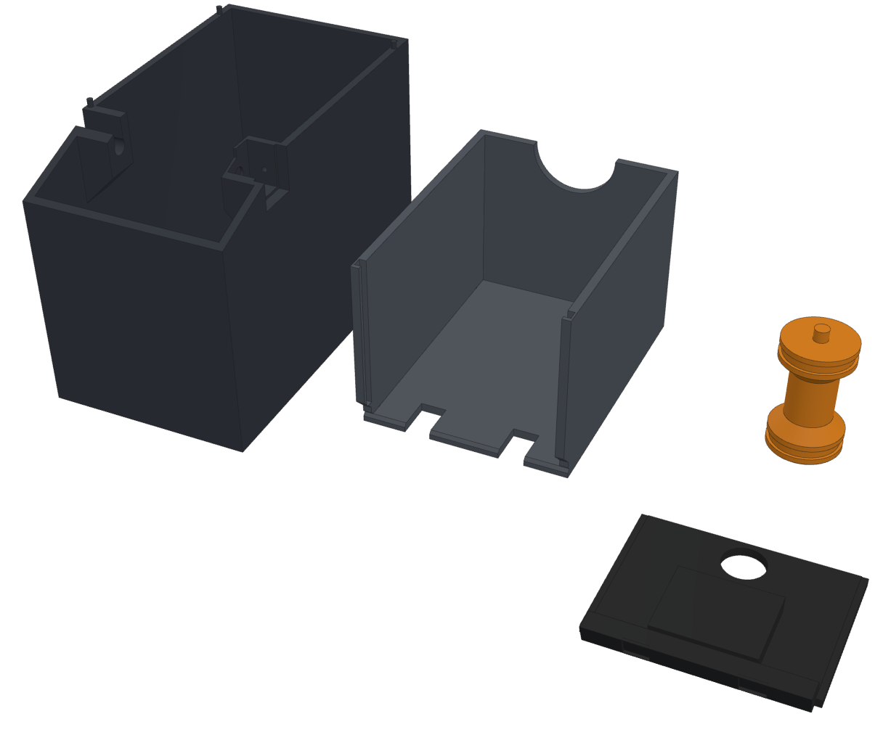
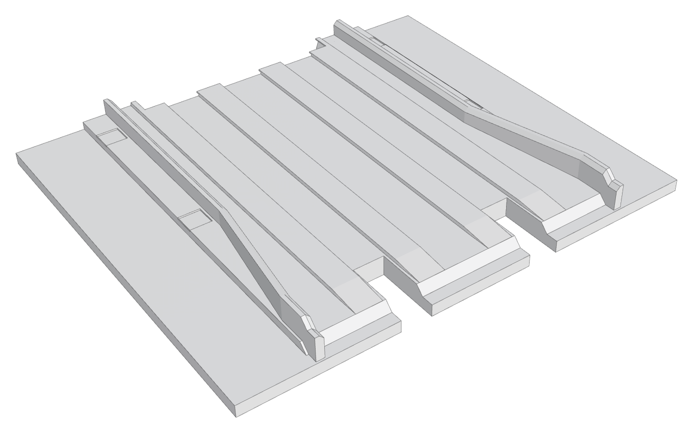

# Feeder box v4: one card per feed, built into the box

Print file: `bambu/MTG_Sorter_Feeder_Box_v4.3mf` (File > Open Project; answer **No** to "load as a single object").
Source: `feeder4.scad`. Pictures: `guide/feeder4/render.py`. Clash checks: `guide/feeder4/check.py`.

## What was wrong with the old box

The camera tests showed three things:

- **The card's tail stayed in the box.** The wheels sat 20 mm behind the gate, so they stopped
  pushing while the card's last 20 mm was still under the stack. It hung there until the next feed
  dragged it out with the next card on top (0, 1 or 3 cards). The app's back-off only hid it.
- **The gate was a gap.** A card is 0.3 mm thick. The gap over the floor was set with a thumb
  screw, so a few tenths either way gave two cards, or none and a grinding motor.
- **The card fell out flat.** It left the hopper level and dropped 5 mm onto the 20° bed, so it
  bent, caught on things and landed crooked.

## What v4 does about it, all in the box

1. **Wheels at the mouth.** The roller sits right under the front of the stack, on fixed bearings
   in the stand. No hinged arm, no rubber band. The wheels push the card until its tail is out of
   the box, so nothing is left hanging and the next card isn't dragged along.
2. **A separator that sets itself.** The box's front wall is a separate part, the **shoe**. It drops
   into two slots and rests by its own weight on the wheels, with a cork pad over each wheel. The
   rubber wheel grips the bottom card harder than the cork does, so the bottom card goes. The cork
   grips the second card harder than two cards grip each other, so the second card stays. This
   works for any card thickness, including foils and curled cards, and needs no adjusting: the shoe
   lifts by exactly one card. It slides straight up and down, so the card being pulled under it
   can't drag it down and lock it, and the stack leaning on it can't lift it.
3. **The card comes out along the bed.** The pad meets the wheels 20° in front of their top, so the
   card leaves at the bed's own 20°, 0.8 mm above the PTFE tape lands. There's no drop, no bend and
   nothing to catch on, and the bed's funnel centres it.
4. **The last cards feed too.** The shoe keeps pressing them onto the wheels after the stack and
   weight are gone.
5. **It drops into the bridge's outline.** The old stand was 73 x 128 mm in a 73.6 x 128.6 outline,
   only 0.3 mm each side, so the first layer's squish stopped it going in. The v4 stand is
   72 x 127 mm, so it has 0.8 mm of room on every side, with a 0.8 mm chamfer round its foot.

*Section through the right wheel: the stack (right), the shoe with its cork pad on the wheel, and
a card leaving along the bed's slope. The bed plate is cut short here by the wheel slot.*

## What to print

| Plate | Part | Colour | Notes |
|---|---|---|---|
| 1 | `feeder4_stand4`, the stand | black | brim; replaces the v2 stand **and** arm |
| 2 | `feeder4_hopper4`, floor and walls | black | brim; replaces the v2 hopper and gate |
| 3 | `feeder4_shoe4` and `feeder4_roller4` | black (any) | **100 % infill** (already set): the shoe's weight is what presses the pads |
| 4 | `bed_chute_bed_plate3`, the scan bed v3.1 | **white** | the same v3.1 plate with **two wheel slots** at its back edge |
| 5 | `bed_chute_stop_gate3`, the v3.2 stop bar | black | only if you haven't printed it yet |

The scan bed plate is the one change outside the box. The wheels now sit so far forward that they
reach past the bed plate's back edge, so the plate has a slot for each wheel between the tape
lands, from 16 mm before its back edge. The card rides on the lands and never touches the slots.
If you've already printed the v3.1 plate, you can cut the two slots yourself: 7.6 mm wide, centred
16.75 mm either side of the middle, 16 mm long from the back edge, right through.

## What else you need

- **Kept from the old box:** the N20 motor and its wires, the two O-rings (20x3 or 22x3), the
  M2 x 8 screw that held the gearbox, and the solid weight.
- **Cork, 1.5 to 2 mm thick**, for the two pads: a cork coaster, a cork board offcut or a self-adhesive
  cork sheet ([Amazon.ca search](https://www.amazon.ca/s?k=self+adhesive+cork+sheet+2mm)). Cork grips
  a card less than rubber does and more than another card does, which is what the pad needs. Don't use
  rubber (it grips as hard as the wheel, so nothing feeds) or PTFE tape (too slippery to hold the
  second card). Until you have cork, the shoe works without pads, but less surely.
- **Coins**, optional: loonies or quarters stand up in the pocket on the shoe's front to press harder.

## Putting it together

1. Cut two cork pads **7.4 x 6.9 mm** and glue them (super glue) into the two pockets under the
   shoe's bottom edge. They should stand about half a millimetre proud.
2. Stretch the O-rings into the new roller's grooves.
3. Push the roller onto the motor's D-shaft. Lay the gearbox into its channel on the right of the
   stand from above, with the motor sticking out through the slot in the right wall, and press the
   roller's stub into the slot on the left until it clicks. Screw the M2 x 8 in from the back of the
   channel until it holds the gearbox snug.
4. Slide the new bed plate in (the slots at its back edge go under the wheels). Turn the roller by
   hand: the wheels should spin freely in the slots.
5. Drop the stand into the bridge's outline, with the wires out through the back.
6. Put the hopper on the stand's four pegs.
7. Lower the shoe down the two slots at the front of the hopper, pads first, until it rests on the
   wheels. It should slide freely. Lift it with the finger hole.
8. Load the cards against the shoe and put the weight on top.

## First feeds

On the Machine page, feed one card at a time and watch it on the camera:

- **Two cards come out:** put a coin in the shoe's pocket (more press on the second card).
- **Nothing comes out, and the motor turns:** take the coins out. If there are none, the cork is too
  grippy: sand it lightly or use thinner cork.
- The next card now waits under the pad, not hanging out of the box, so the **back-off isn't needed**:
  set it to 0 (or 0.2 at most). The card is let go about 10 mm before the stop and slides the rest on
  the PTFE tape, so re-check the landing zone once.

## Checked in CAD

`guide/feeder4/check.py` intersects the parts in OpenSCAD; all of these come out empty:
the wheels (with 0.3 mm to spare) against the bed plate, stand, hopper and shoe; the roller in the
stand; the stand against the bed plate, both bed side walls, the tilt bracket, the gate bearing and
the stop bar; the hopper against the bed and its walls; the shoe against the bed (also when it drops
to the bottom of its slots with no roller in) and the hopper; the motor against the bed (0.8 mm
clear) and the stand; a card on its way out against the bed, hopper and shoe; and the stand against
the bridge's fence.

## Limits

- Unsleeved cards only, like the v3 bed (the hopper is 67 mm inside, the bed channel 65).
- The enclosure's hopper **tower** has a front wall where the hopper's front is (the old box had the
  same clash). If you fit the tower, its front wall has to be cut away in front of the hopper.
- Not printed or tested yet: the cork, the coin count and the landing zone may need a first run to
  settle.

## Rebuilding

    for p in stand4 hopper4 shoe4 roller4; do openscad -o stl/feeder4_$p.stl -D "part=\"$p\"" feeder4.scad; done
    openscad -o stl/bed_chute_bed_plate3.stl -D 'part="bed_plate3"' bed_chute.scad
    python3 guide/feeder4/stl2bin.py stl/feeder4_*.stl stl/bed_chute_bed_plate3.stl   # OpenSCAD 2021 writes text STLs
    python3 bambu/make_small_projects.py MTG_Sorter_Feeder_Box_v4.3mf MTG_Sorter_Scan_Bed_v3.3mf
    python3 guide/feeder4/check.py
    python3 guide/feeder4/render.py
