# Mechanism v2: new feeder, scan bed stop and door carriers

This replaces the parts that went wrong on the first test run:

| Problem | Cause | v2 fix |
|---|---|---|
| The roller didn't touch the cards | It only poked 0.8 mm above the hopper floor, fixed in place | Two O-ring wheels on a **hinged arm**. A rubber band pushes them up into the stack, and a stop keeps them 2.5 mm proud |
| Cards flew past the stop pins | Two thin pins, only 2.4 mm tall | A **stop gate**: four teeth, 8 mm tall, across the whole card, held at both ends |
| Servos got hot, and the tray couldn't tilt fully | At 25° the trapdoor servos dipped 4 mm into `bridge_front` | **Door carriers** with the servos turned to point inwards. They clear the bridge at 25° (checked in CAD) |

Everything else stays as it is: the enclosure, bridge, bed walls, chute tray, trapdoors, tilt bracket and wiring.

A single-file version with the pictures inside: [`mechanism_v2_guide.html`](mechanism_v2_guide.html) (download it and open it in a browser). In the pictures **grey** is already fitted, **orange** is what the step adds, **pink arrows** show where it goes, and numbered circles match the numbers in the text.

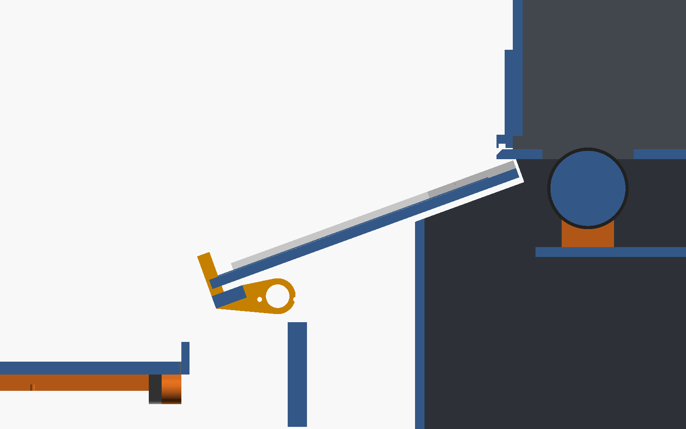

## Print

Open **`bambu/MTG_Sorter_Feeder_And_Bed_v2.3mf`** with **File > Open Project** (not Import). The settings are already applied. There are five plates:

| Plate | Parts | Filament |
|---|---|---|
| 1 | feeder stand (with brim) | black |
| 2 | feeder hopper (with brim) | black |
| 3 | feeder arm, roller (100% infill), gate, weight | black |
| 4 | scan bed plate | **white** |
| 5 | stop gate, gate bearing, both door carriers | black |

No supports anywhere. You can stop using these old parts: `pin_rocker`, the old roller, hopper, gate and stand, and the old door carriers.

## Bits you need

- A small rubber band, about **4 cm long lying flat**. A 40–50 mm O-ring from the kit works too.
- Two 3 mm O-rings for the wheels (20 × 3 or 22 × 3), as before.
- One **1.9 mm thick O-ring** from the kit (any size), cut open into a strip. This is the gate's rubber pad.
- Coins or nuts for the weight plate: two loonies, quarters or M8 nuts per pocket.
- Screws: 2 × M3 × 8 (arm hinge), 1 × M3 × 12 (thumb screw), 2 × M3 × 8 (gate lock, as before), 2 × M2 × 6 (motor pinch and gate bearing).

## The feeder

Build it on the bench. It sits on the bridge in the same spot as the old one, same footprint.

### 1. Wheels

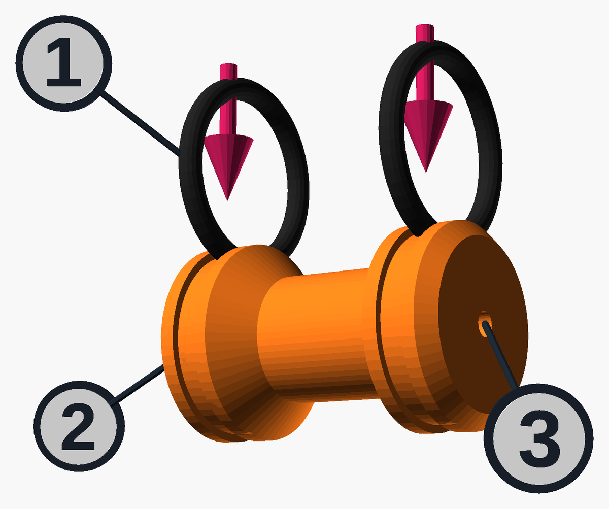

- **(1)** Stretch a 3 mm O-ring into each groove on the roller.
- **(2)** is the stub axle, **(3)** the D-shaped hole for the motor shaft.

**Parts:** `feeder_roller`  
**You need:** 2 × 3 mm O-ring

### 2. Motor into the arm

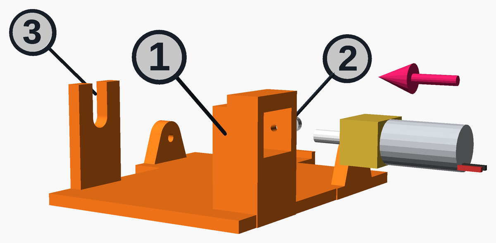

- Slide the N20 into the square tunnel from the outside, shaft first, until the gearbox stops against the end wall **(1)**.
- **(2)** Snug the M2 screw in the side of the tunnel to pinch the gearbox. Don't overtighten it.
- **(3)** The slot in the left plate is for the roller's stub.

**Parts:** `feeder_arm`  
**You need:** N20 motor, 1 × M2 × 6

### 3. Roller onto the motor

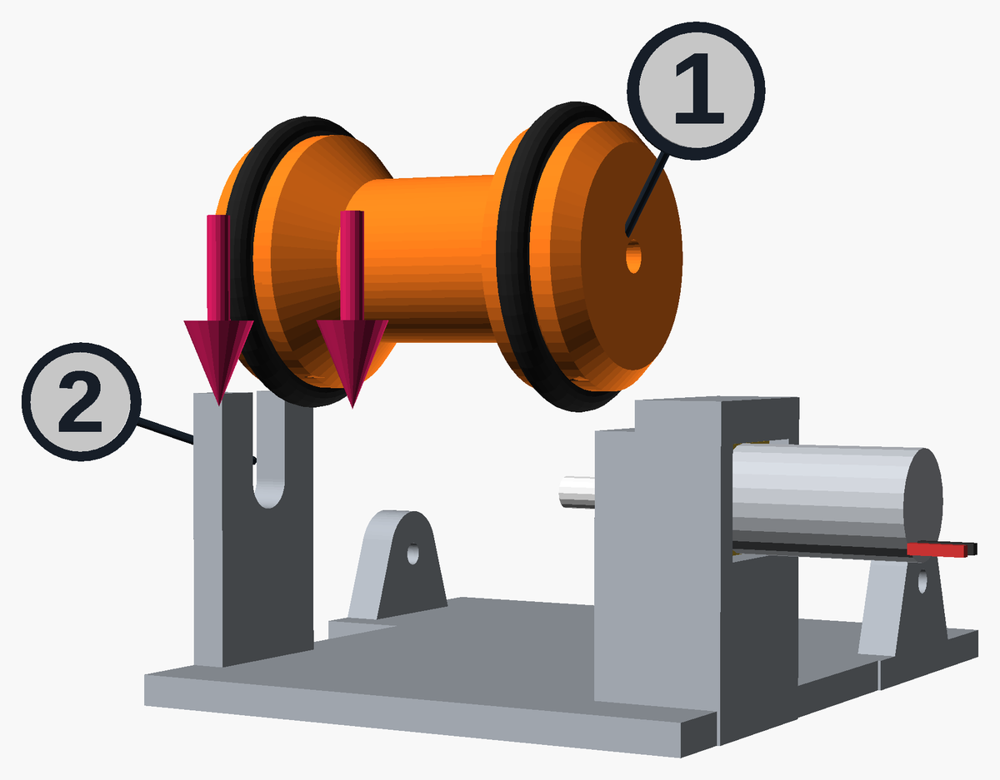

- **(1)** Line up the flat in the roller's hole with the flat on the shaft and press it on.
- **(2)** The stub at the other end drops into the slot in the arm's left plate.
- Spin it by hand: it should turn with the motor and not rub.

### 4. Arm into the stand

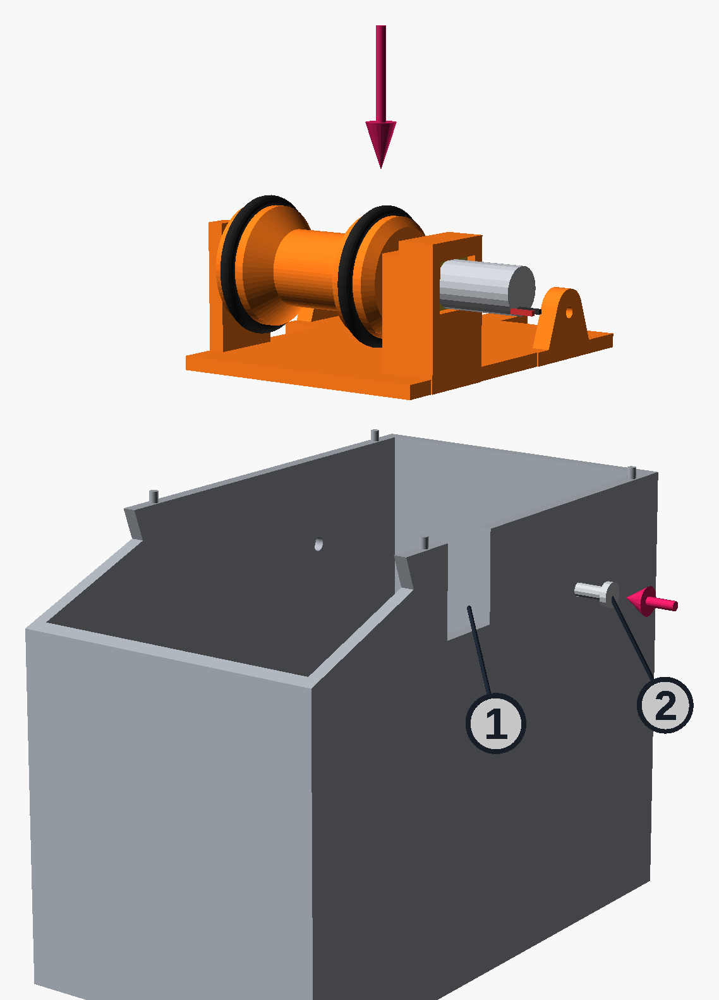

- With the hopper off, lower the arm in from the top.
- **(1)** The motor slides down the open slot in the right wall.
- **(2)** Put an M3 × 8 through each side wall into the arm's hinge. The arm should swing up and down freely.

**Parts:** `feeder_stand_mid`  
**You need:** 2 × M3 × 8

### 5. Rubber band

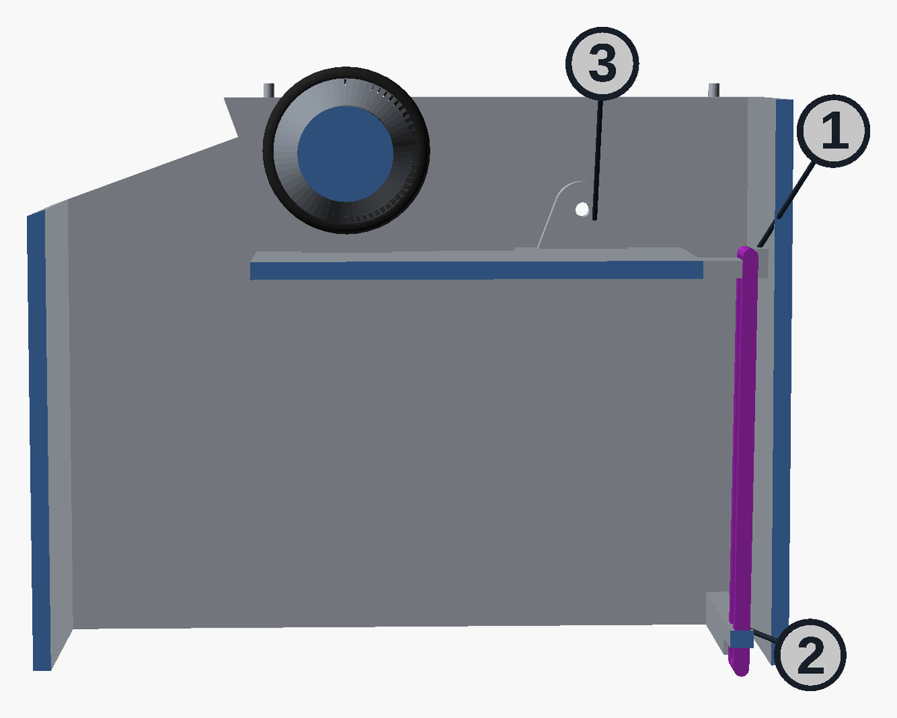

- This picture is cut open down the middle so you can see inside.
- Loop the band under the bar at the bottom back of the stand **(2)**, through the notch, and over the arm's tail tongue **(1)**. The bump at the end of the tongue keeps it on.
- The band pulls the tail down, so the arm turns on its hinge **(3)** and the wheels push up. Press the wheels down: they should push back firmly.

**You need:** rubber band, ~4 cm

### 6. Hopper on

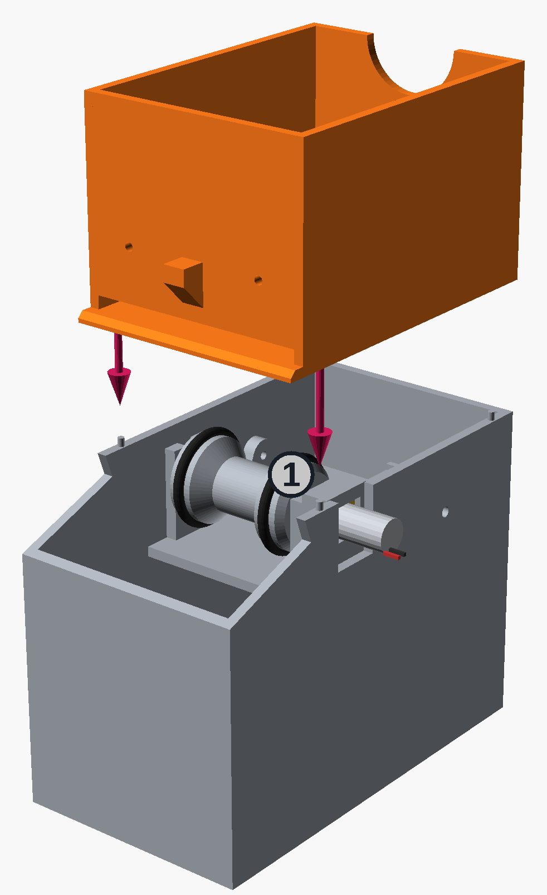

- Set the hopper on the four pegs at the top of the stand.
- **(1)** The O-rings now stand about 2.5 mm above the floor. Press them down with a finger and they should spring back.

**Parts:** `feeder_hopper`

### 7. Gate

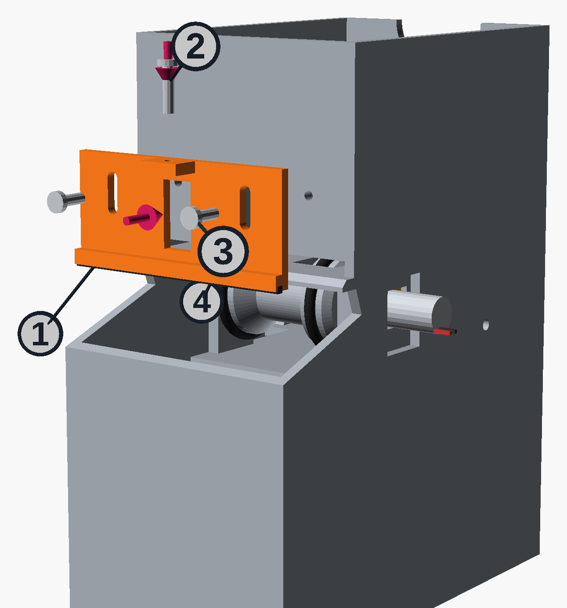

- **(1)** Press the cut 1.9 mm O-ring into the groove under the gate's bottom edge. A dab of glue helps.
- Hang the gate on the front wall with the two lock screws **(3)** loose.
- **(2)** Drive the M3 × 12 down through the tab until its tip rests on the little shelf **(4)** that pokes out through the gate's window.
- Slip one card under the gate and turn the thumb screw until the card just drags when you pull it. Tighten the lock screws and take the card out.

**Parts:** `feeder_gate`  
**You need:** 1 × M3 × 12, 2 × M3 × 8, 1.9 mm O-ring, cut

### 8. Cards and weight

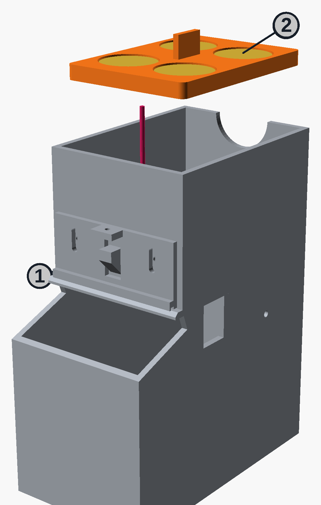

- **(1)** Load the cards face up.
- **(2)** Put the weight plate on top with coins in its pockets. Lift it out by the handle.

**Parts:** `feeder_weight`  
**You need:** 8 coins or M8 nuts

### 9. How it works

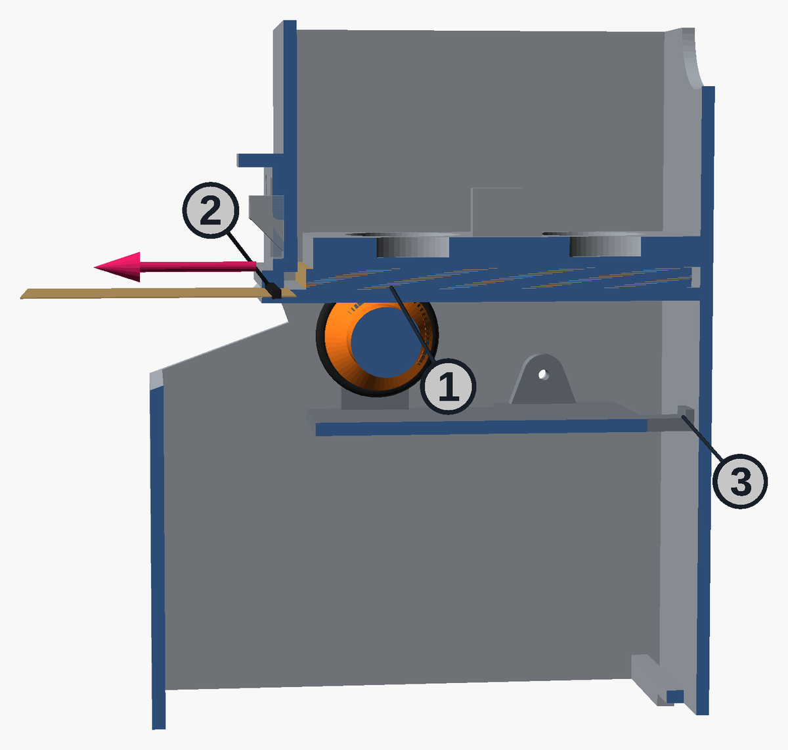

- **(1)** The wheels push up into the stack and roll the bottom card forward, out under the gate and down onto the bed.
- **(2)** The rubber pad under the gate holds the next card back, so only one comes out.
- **(3)** The rubber band keeps the wheels pressed up as the stack gets lower.
- Wiring is the same as before. If the wheels push cards **backwards**, swap the motor's two wires.

## The scan bed stop gate

The stop gate replaces the two stop pins. It uses the same pin servo, still on the left wall. Take out the old pin rocker and slide the old bed plate out of its grooves first. Leave the pin servo where it is. The right bed wall is left out of these pictures so you can see in.

### 10. Gate bearing

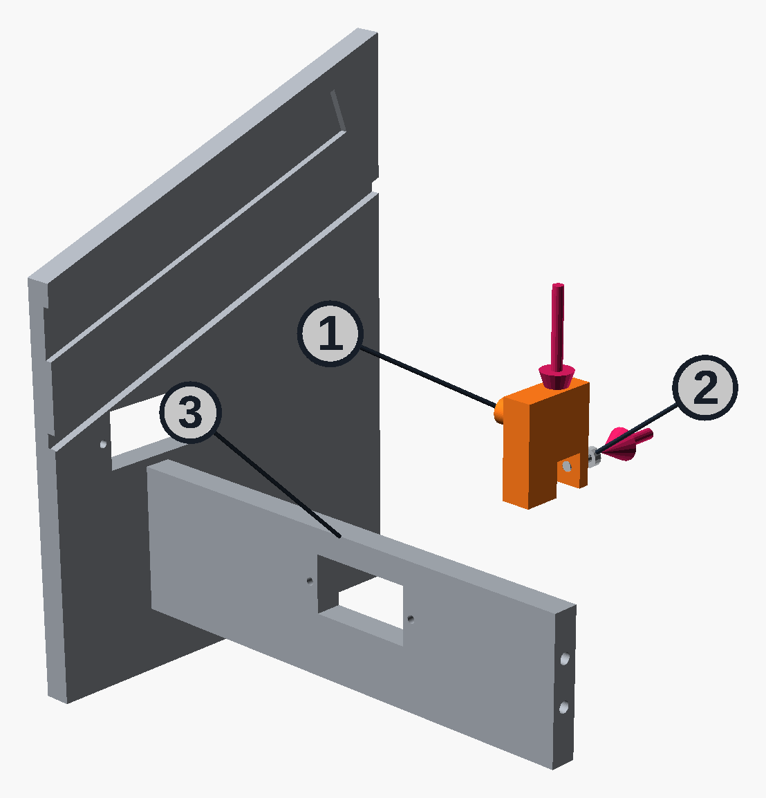

- **(1)** Push the gate bearing down over the **right** end of the tilt bracket **(3)**, between the bracket and the right bed wall, with its pin pointing to the middle.
- **(2)** Put an M2 × 6 through its back jaw into the bracket.

**Parts:** `bed_chute_gate_bearing`  
**You need:** 1 × M2 × 6

### 11. Horn on the stop gate

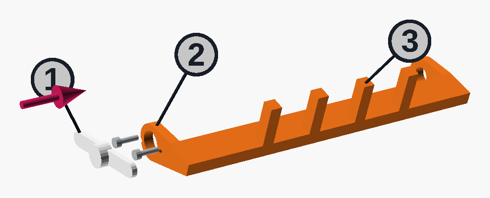

- **(1)** Screw the double-arm horn to the stop gate's left plate **(2)**, using the two horn holes nearest the hub, as with the old rocker.
- **(3)** are the four teeth that stop the card.

**Parts:** `bed_chute_stop_gate`  
**You need:** servo horn and its 2 small screws

### 12. Fit the stop gate

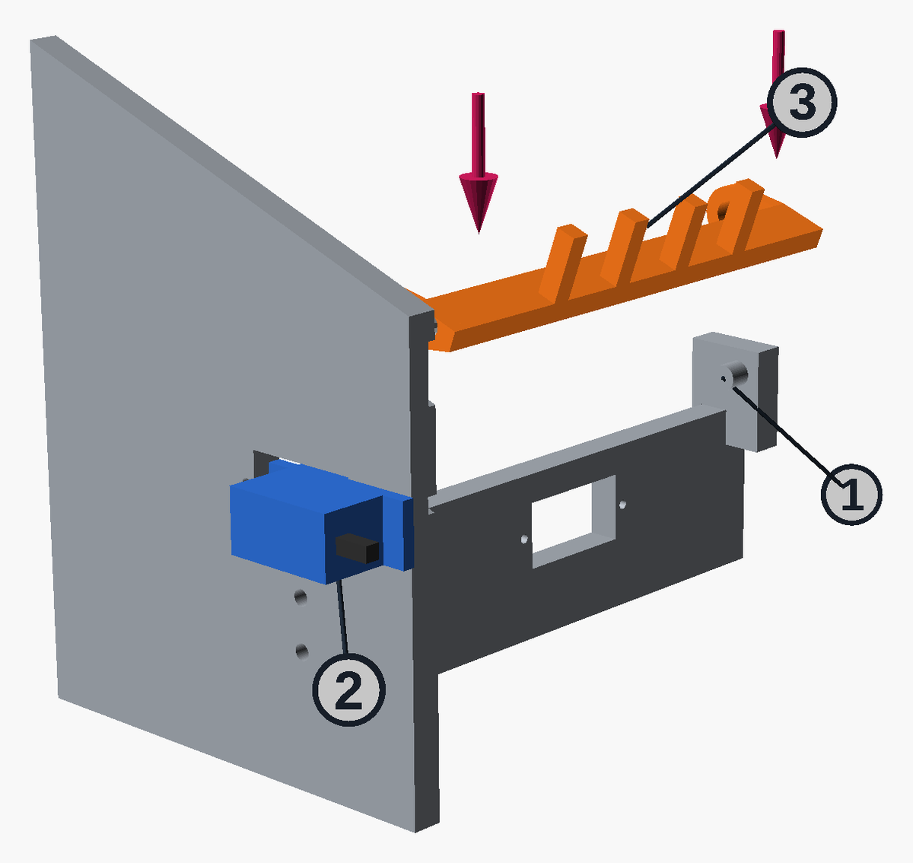

- Centre the pin servo at 90 first (Machine page, Pins).
- **(1)** Hook the right plate's hole over the bearing pin.
- **(2)** Then push the horn onto the servo shaft, with the teeth **(3)** pointing up. Fit the horn's centre screw.

**You need:** horn centre screw

### 13. New bed plate in

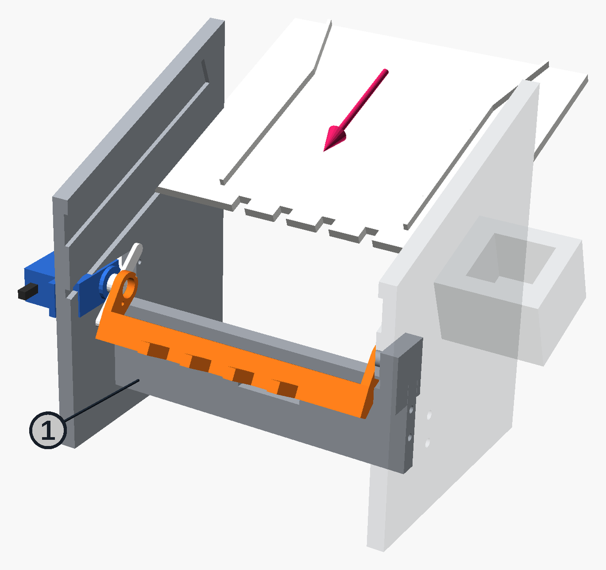

- On the Machine page, move **Pins** to about 50 so the teeth **(1)** swing down.
- Slide the new white bed plate down its grooves from the top, rails up.

**Parts:** `bed_chute_bed_plate (white)`

### 14. Teeth up

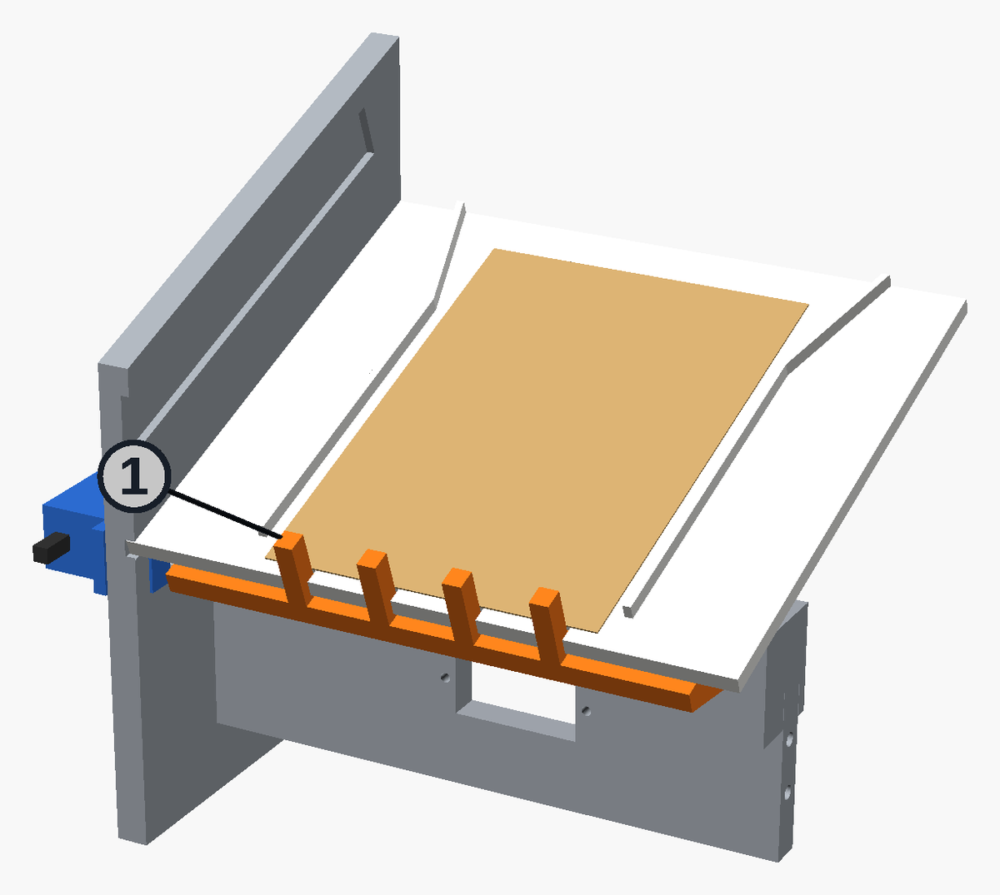

- Move **Pins** back to 90.
- **(1)** The four teeth come up through the slots at the bed's front edge, about 8 mm tall. A card coming down the bed stops on them.
- At 50 they drop below the bed and the card slides off into the chute.

## Door carriers

The chute itself doesn't change. Only the two carriers under it do.

### 15. Swap the door carriers

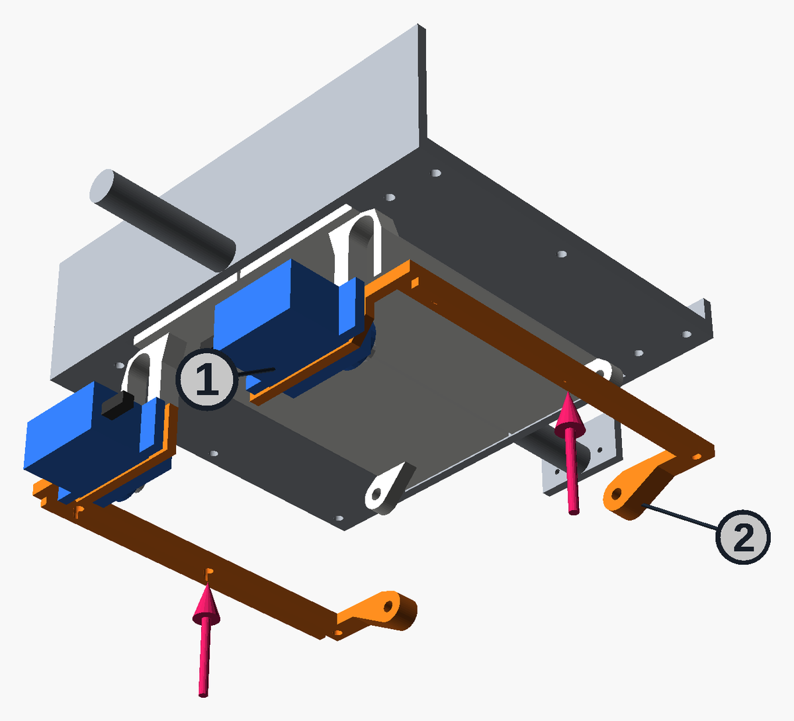

- Unscrew the chute and swap each door carrier for the new one, with the same screws.
- **(1)** The servo goes in the same way, except its body now points **in** towards the middle of the tray instead of out past the door. That is what keeps it off `bridge_front` when the tray tilts.
- **(2)** The hinge lug at the back is the same. The horn still slides up into the door's fork.

**Parts:** `bed_chute_door_carrier`, `bed_chute_door_carrier_left`

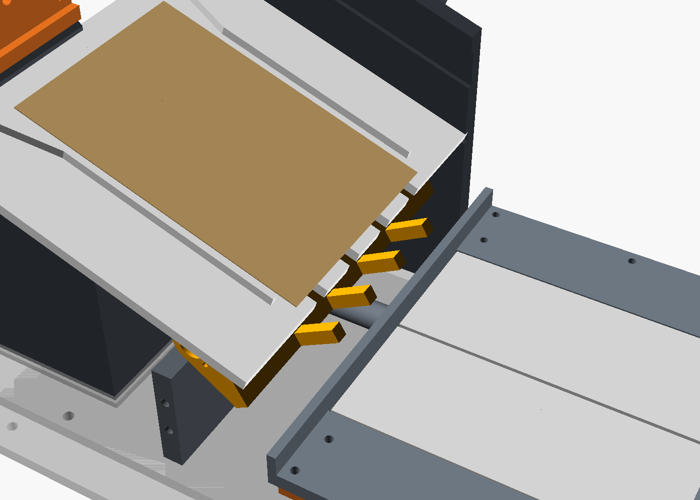

## Servo angles to save on the Machine page

| Part | Positions | Why |
|---|---|---|
| Pins (the stop gate) | up **90**, down **50** | 40° drops the teeth well clear. CAD shows no contact from 6° past up to 44° down |
| Chute | centre 90, left **68**, right **112** | 22° each way. The servos now clear the bridge even at 25°, but 22° leaves about 2.5 mm |
| Doors | unchanged |  |

Press **Save** after each one. If cards stick in the tray at 22°, try 24°.

## If something's off

| What you see | Try |
|---|---|
| Two cards come out | Lower the gate a quarter turn of the thumb screw |
| Nothing comes out, wheels spin | Add a second wrap of the rubber band, or more coins on the weight |
| Card lands crooked on the bed | The funnel at the top of the bed should straighten it. If not, check that both wheels touch the card |
| The pin servo buzzes with the teeth up | The bar is pressing on the bed's underside: save "up" a few degrees lower (towards 50) |

---

Pictures: `python3 guide/v2/render.py` (needs OpenSCAD), then `python3 guide/v2/build.py`.
