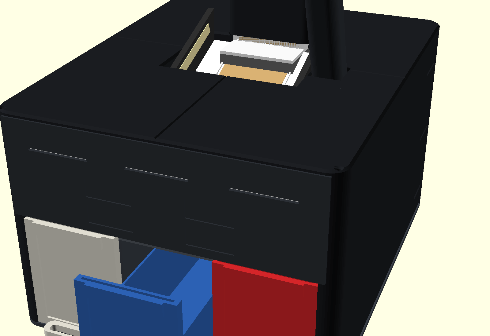
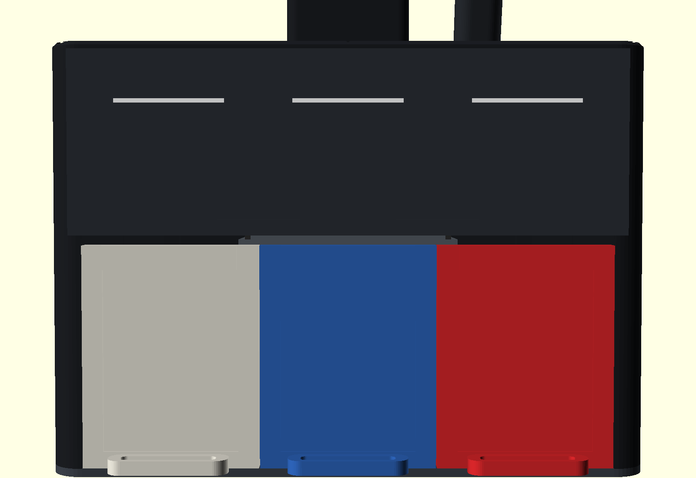
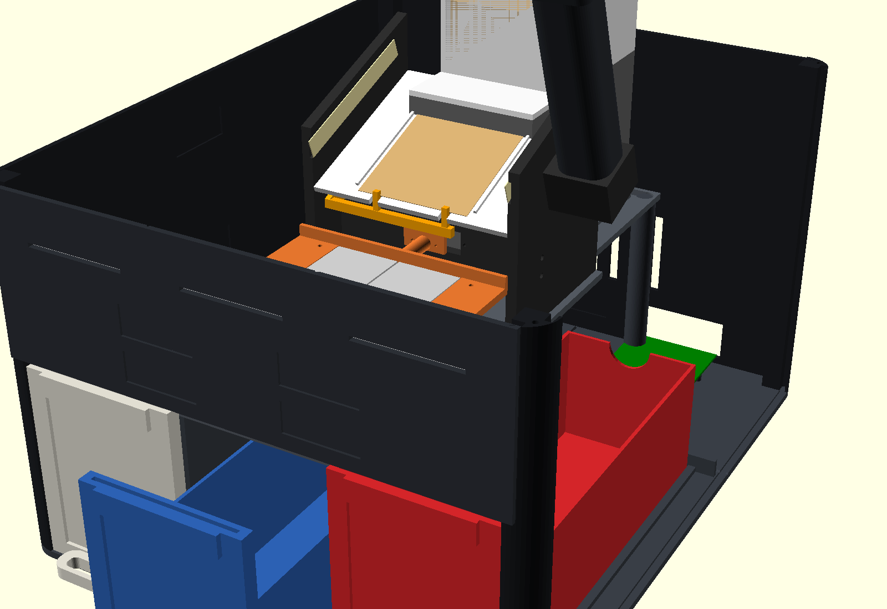

# Hardware

Step-by-step build: [ASSEMBLY.md](ASSEMBLY.md).

- [Feeder test rig](#feeder-test-rig): the first piece of the full sifter
- [Scan bed and chute](#scan-bed-and-chute): the middle of the sifter: stops the card for its photo, then sorts it into a bin
- [Enclosure](#enclosure): the sleek box around it all, with Nic's storage drawers as the bins

The first camera stand (the "scan station") and the open-frame concept are gone; the
enclosure replaced them. They're in the git history before 2026-10-25 if ever needed.

# Feeder test rig

The hardest part of any card sorter is getting **exactly one** card out of the stack
every time. Two stuck together, or none at all, and the sort is wrong. So this gets
built and tested on its own first.

A roller with rubber O-rings sits under the stack and pokes 0.8 mm up through the floor.
When it turns, it drags the bottom card forward under the **gate**: a plate whose bottom
edge sits just over one card's thickness above the floor. One card fits under it, two don't.

| File | Print | Notes |
|---|---|---|
| `stl/feeder_stand_mid.stl` | as it opens, 15% infill | The box underneath, with the motor cradle. 96 mm, with its front cut away under the sloped bed: the height it needs on the enclosure's bridge |
| `stl/feeder_hopper.stl` | as it opens, 15% infill | Floor and walls. Holds about 190 cards |
| `stl/feeder_gate.stl` | flat | The adjustable gate |
| `stl/feeder_roller.stl` | standing on its end, **100% infill** | Goes on the motor shaft |

### Parts to buy

| Part | Notes |
|---|---|
| N20 gear motor, 6 V, **100–200 RPM**, 3 mm D-shaft | Very common, a few dollars |
| 2× O-rings, **20 mm inside × 3 mm thick**, nitrile | They're the "tyre" on the roller. Hardware store or Amazon |
| 2× M3 × 10 mm self-tapping screws | Hold the gate |
| A couple of small zip ties | Strap the motor to its cradle |
| 4× AA battery holder with a switch | Enough to test. A Raspberry Pi controls it later |

### Putting it together

1. Stretch the two O-rings into the grooves on the roller.
2. Push the roller onto the motor shaft (the flat side of the hole matches the flat on the shaft).
3. Slide the motor in through the hole in the side of the stand, so the roller is in the middle
   under the floor opening. Strap it down with zip ties through the slots in the cradle.
4. Set the hopper on top of the stand. The small pegs line it up.
5. Screw the gate loosely onto the front of the hopper.

### Setting the gate

1. Slide one card under the gate and push the gate down onto it.
2. Tighten the screws, then pull the card out.

That leaves a gap of about one card. If cards jam, loosen the screws and raise the gate a
hair. Sleeved cards need a bigger gap: use a sleeved card in step 1.

### Testing

Put 20 cards in the hopper and tap the motor's switch on for a moment at a time. Each tap
should push out one card.

| What happens | Try |
|---|---|
| Two cards come out together | Lower the gate a little |
| Nothing comes out, the roller spins | Clean the O-rings with a damp cloth, or put something heavy on the stack |
| Cards come out crooked | Check the roller is centred, and both O-rings are seated |
| It works with 20 cards but not 150 | Normal at first. Note it, and we'll tune the gate and roller together |

Count how many cards out of 100 come out on their own. That number tells us whether
the design works or what to change.

# Scan bed and chute

`bed_chute.scad`. The card comes off the feeder onto the scan bed, gets its photo, and
drops into the chute, which sends it to one of three bins.

1. **Scan bed** (white, sloped 20°): the card slides down until **two small pins** near
   the front edge stop it, square under the camera. LED strips in both side walls light it.
2. **Photo.** Then a servo swings the pins down below the bed, and the card slides off.
3. **Chute**: a level tray above the bins catches it.
   - **Bin 2 (middle):** two small trapdoors in the tray floor drop open, like bomb-bay
     doors, and the card falls straight down. (Two half-width doors, because one full-width
     door would swing down into the middle bin.)
   - **Bin 1 or bin 3:** a servo tilts the whole tray 25° left or right and the card slides
     off that end. The frame's side panels stop it flying past the bin.

Every moving part was checked in OpenSCAD for collisions at both ends of its travel:
the tray tilted both ways, the trapdoors open, and the pins up and down.

### Parts to print (`stl/bed_chute_*.stl`)

| File | How many | Colour | Notes |
|---|---|---|---|
| `bed_plate` | 1 | **white** | The surface the camera looks at |
| `bed_side_left_enclosure`, `bed_side_right_enclosure` | 1 each | black | lie them flat. Right one has the camera socket; both have the foot flange that screws to the enclosure's bridge |
| `tower_post`, `camera_head` | 1 each | black | |
| `pin_rocker` | 1 | any | The two stop pins |
| `tilt_bracket` | 1 | black | |
| `chute` | 1 | any | The tray |
| `trapdoor`, `trapdoor_left` | 1 each | any | |
| `door_carrier`, `door_carrier_left` | 1 each | any | servo mount + hinge lug in one; prints upside down (as exported). Replaces `trapdoor_mount` + `hinge_lug` |

All print flat, as they open, with no supports. 15–20% infill is fine. The open frame and
the three bins the bed first sat in (`frame_side`, `front_bar`, `bin`) are gone: the
[enclosure](#enclosure) and its drawers replaced them.

### Moving parts

| Job | Part |
|---|---|
| Stop pins up / down | SG90 servo, on the left bed wall |
| Tilt the tray | **MG90S** servo (metal gears), on the tilt bracket |
| Trapdoors | 2× SG90 servos, under the front of the tray |

A PCA9685 servo board connects all four servos to the Raspberry Pi. The feeder rig sits
behind the bed on its stand (`feeder_stand_mid`, 96 mm, on the enclosure's bridge), so cards
come off its exit shelf straight onto the bed.

# Enclosure

`enclosure.scad`, `card_catalog_drawer.scad`. A countertop box in the style of the Roca Sorter:
black shell with rounded corners, a lighter band across the front, the scan bed sunk into
the top deck, a rounded tower over the hopper and a rounded arm over the camera post.
Everything inside is the same bed, pins, camera tower, chute and feeder as above.





The three bins are **Card Catalog v1.2 drawers** (MakerWorld
[Card Catalog](https://makerworld.com/en/models/3016550-card-catalog-v1-0), by Aspect of
Frost): the long tray with a 3 × 4 toploader pocket in its front plate that Nic's card
shelf is built from. A full drawer slides out of the sorter and straight into a cubby of
the shelf. The drawers themselves are printed from the MakerWorld 3MF, which isn't in this
repo; the dock is sized from it:

| Measured from the 3MF | mm |
|---|---|
| Tray | 76 wide × 67.4 tall × 223 long |
| Front plate | 86 wide × 109 tall × 8 thick, plus a clip-on top bar |
| Plate pitch in the Card Catalog box | 86.5 (0.5 between plates) |
| Room above the cubby floor in the box | 113.5 |

The dock copies the box: the three plates sit side by side between the two front posts,
flush with the fascia, the trays run between 3 mm **guide curbs** on the floor, and the
fascia starts 114 mm above the floor. These numbers are the `dr_*` block at the top of
`enclosure.scad`; everything else follows from them.

## How it goes together

```
            ┌───────── deck (4 tiles, screwed to the posts) ─────────┐
   post ──► │  fascia  │  scan bay  │  hopper tower  │  back panel  │ ◄── post
            │ ┌──────┐ │   bridge plate: bed walls, chute, feeder   │
            │ │drawer│ │ ───────────────────────────────────────────│
            │ │drawer│ │  dividers carry the bridge │  Pi bay       │
            │ │drawer│ │ ───────────── floor (4 tiles) ─────────────│
            └──────────────────────────────────────────────────────┘
```

- The **floor** is a base plate with rounded corners. Everything stands on it: the four
  **corner posts** peg into it, and the **side**, **fascia** and **back** panels slide
  down into the posts' grooves and stand in a groove in the floor. Stick-on rubber feet
  go in the recesses underneath. The front half is the drawer dock: guide curbs on the
  floor keep the trays in line, and two **dividers** stand in grooves in the middle curbs.
  The front posts' inner faces are the dock's cheeks; the outer plates slide along them.
- The **fascia** is three pieces, and its seams sit right above the gaps between the
  drawer plates, so the lines run from the floor to the deck, one bay each. Each bay has
  its own light slot. The **back** panel is two pieces, seam down the middle. Both are
  wider than the bed, that's all.
- The **bridge** is the plate the mechanism stands on, above the drawers. It rests on the
  dividers' top flanges at the front and on two **legs** at the back. The bed walls screw
  to it with a new foot flange (`wall_z0 = 111` in `bed_chute.scad`), the feeder stands on
  it on a shorter stand (`stand_h = 92` in `feeder_test.scad`), and an upstand at its
  front holds the chute's front axle instead of `front_bar`. Cards fall through openings
  in it into the drawers.
- The **deck** tiles screw down onto the posts. The bay opening fits round the bed walls;
  the camera post comes up through a hole and gets a round **sleeve** and a **head cover**;
  the **tower** sits over the hopper, with a lid.
- The Pi, PCA9685 and motor driver sit in the bay behind the dock, under the bridge, on
  standoffs in the floor. Ports and vents are cut in the back panel, and there are intake
  slots in the floor under the Pi, so air can move. Fit the Pi 5's Active Cooler (or any
  fan heatsink under 25 mm) and it'll stay cool in there.
- A **light bar** sits behind the three slots in the fascia: one white strip, glued across
  the fascia seams (it ties the three pieces together), with a piece of the LED strip stuck
  behind it. Lit, it's the thin line across the front that the Roca has, in three dashes,
  one per drawer. Unlit, it's a white line.

Plates too big for the 256 mm bed are split into tiles that meet at a seam, and joined on
the bench with **splice** strips that sit in pockets on the underside (M2 screws or glue).

## Parts to print (`stl/enc_*.stl`)

| File | How many | Colour | Notes |
|---|---|---|---|
| `post_front`, `post_front_r` | 1 each | black | front-left and front-right corner posts. Mirror images: printing `post_front` twice gives two left posts. Print standing, pegs up, 204 mm tall |
| `post_back` | 2 | black | same for both back corners |
| `side` | 4 | black | two per side; flip the second one end for end |
| `fascia_l`, `fascia_m`, `fascia_r` | 1 each | black (dark grey later, if you like) | the band across the front, left to right |
| `light_bar` | 1 | **white** | behind the three slots, glued across the fascia seams |
| `back_l`, `back_r` | 1 each | black | port and vent cut-outs; l/r as seen from the front |
| `floor_fl`, `floor_fr`, `floor_bl`, `floor_br` | 1 each | black | the base plate; its edge shows |
| `deck_fl`, `deck_fr`, `deck_bl`, `deck_br` | 1 each | black | print as they open (upside down) |
| `divider` | 2 | any | |
| `bridge_front`, `bridge_back` | 1 each | any | |
| `leg` | 2 | any | |
| `leg_offset` | 0 or 1 | any | only for a floor printed with the Pi at x = 40: replaces the right rear `leg`, standing beside the Pi |
| `splice` | 26 | any | 24 used (floor 6, bridge 2, deck 2, fascia 4, back 4, sides 6), 2 spare |
| `tower`, `tower_lid` | 1 each | black | |
| `post_sleeve`, `head_cover` | 1 each | black | |
| Card Catalog v1.2 drawer + drawer top | 3 each | your choice | from the MakerWorld 3MF, not this repo |

Plus `stl/bed_chute_bed_side_left_enclosure.stl` and `..._right_enclosure.stl` (the bed
walls starting at the bridge, with screw holes in their bottom edge) and
`stl/feeder_stand_mid.stl` (92 mm).
`export_enclosure.sh` regenerates all of these. Every part fits the A1's bed; the widest
flat parts (floor and deck tiles) are 146 × 240 mm, and the shell is 292 wide, 356 deep,
212 tall plus the tower and the camera arm.

All flat parts print as they open, no supports, 0.2 mm, 15–20% infill. The posts stand up.
**[`bambu/MTG_Sorter_Enclosure.3mf`](bambu/) is all of it as one Bambu Studio project (File → Open Project), every plate laid out and set up. [`PRINTING.md`](PRINTING.md) has the plate-by-plate print order, the slicer settings
per part, colours, and the three fit-check plates to print first.**
**[`ASSEMBLY_PICTURES.md`](ASSEMBLY_PICTURES.md) shows the build one picture per step.**
Every seam between two tiles has a small V along it on the visible face, so the joints
read as panel lines rather than cracks, and the deck has a 2 mm chamfer round its top
edges and its openings.

Other parts: 6 stick-on rubber feet (8 mm), about 20 M3 × 8 and 30 M2 × 6 self-tapping
screws, 8 M2.5 × 6 for the Pi and the PCA9685, CA glue for the splices in the thin panels (fascia, back,
sides: their pockets are too shallow for screws).
