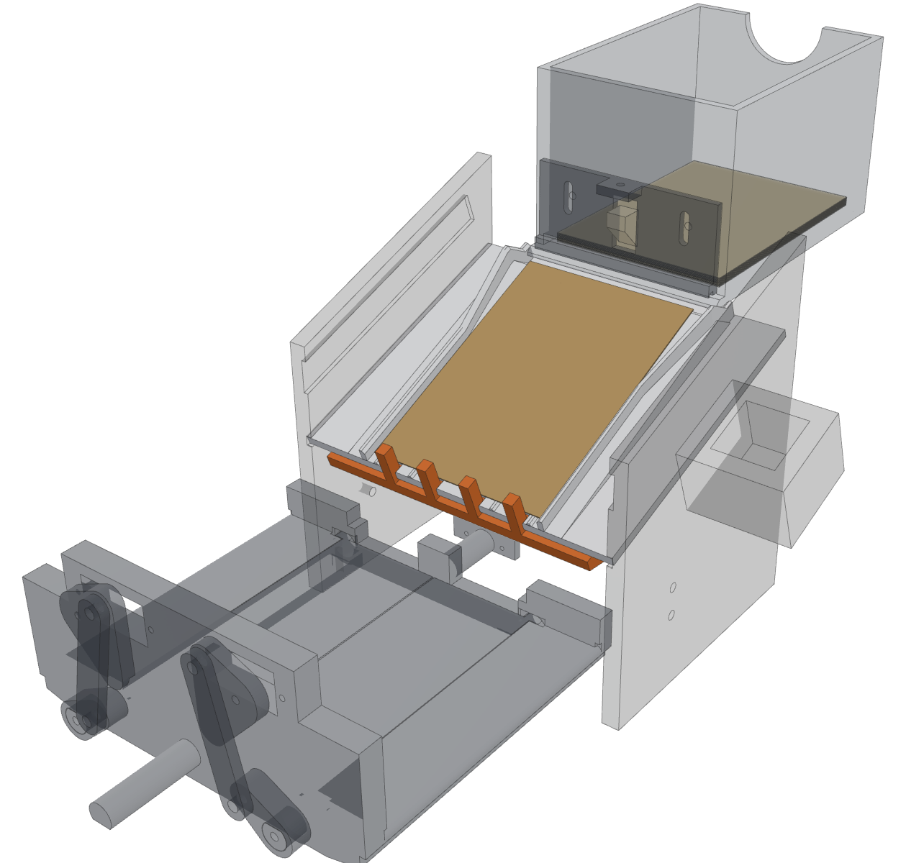
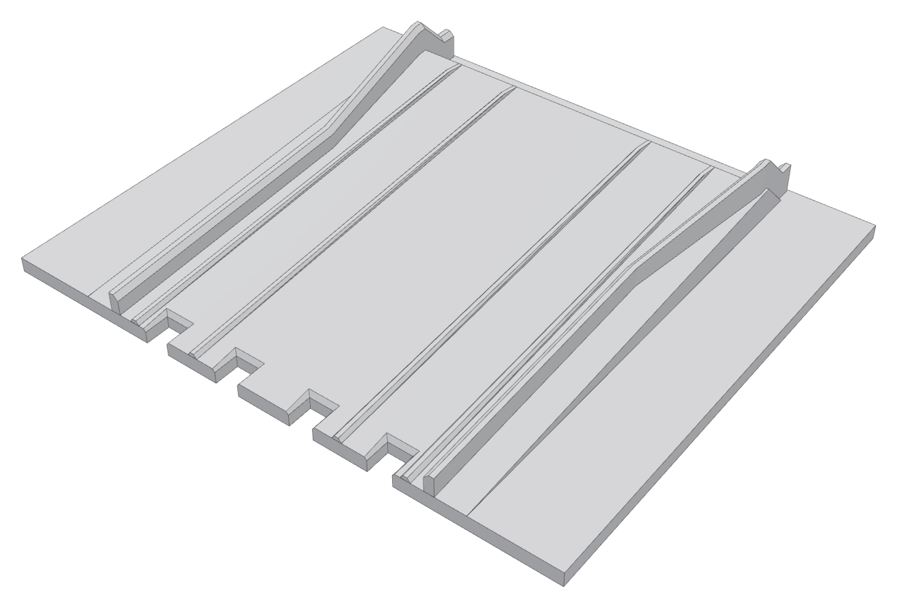
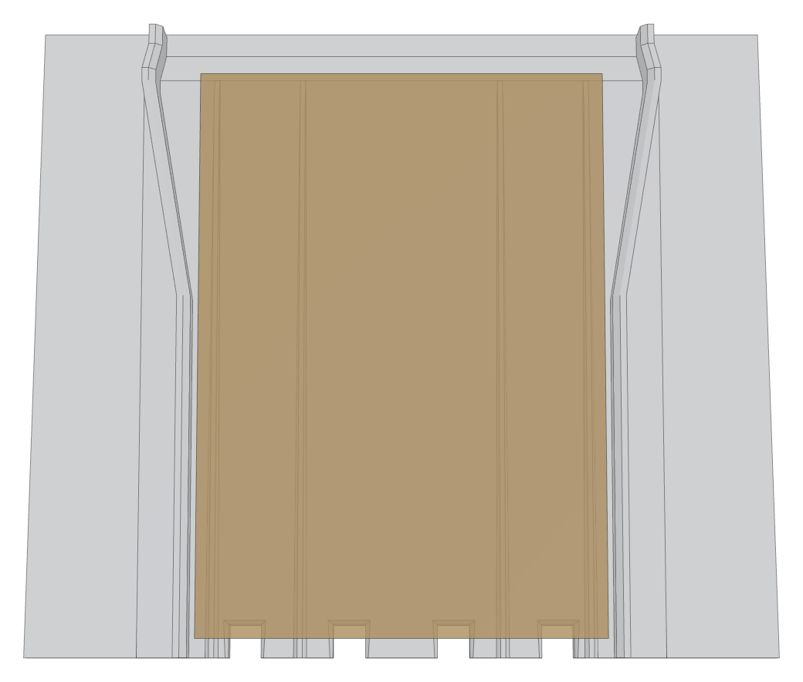
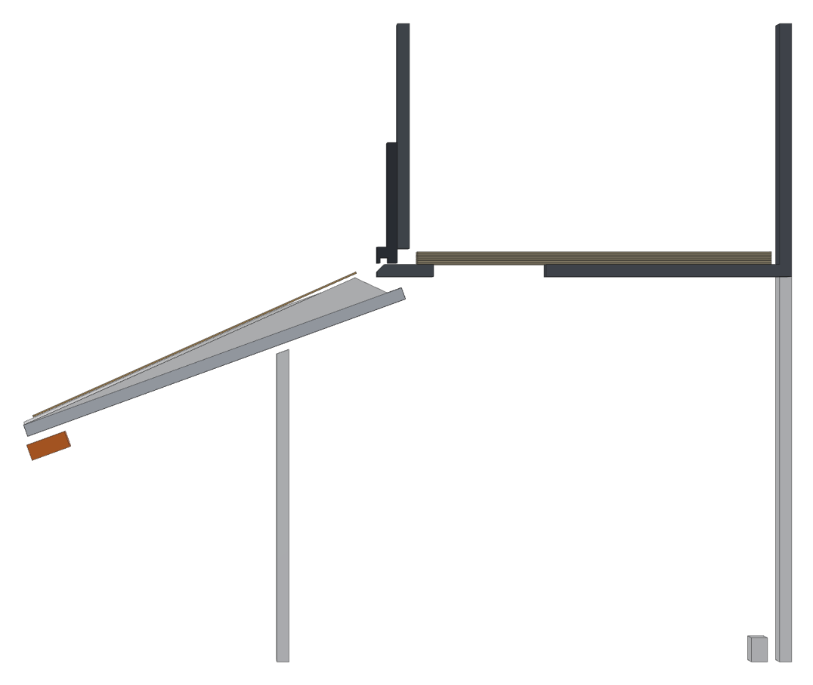
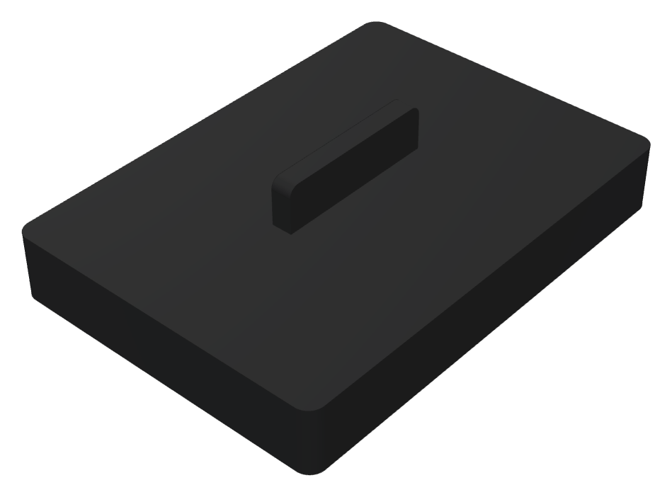

# Scan bed v3 and the solid hopper weight

Print file: `bambu/MTG_Sorter_Scan_Bed_v3.3mf` (File > Open Project; answer **No** to "load as a single object").

| Plate | Part | Colour | Notes |
|---|---|---|---|
| 1 | `bed_plate3`, the new scan bed | **white** | 0.12 mm layers (set in the file), no supports, flat side down |
| 2 | `weight_solid`, the hopper weight | any | 100 % infill (set in the file), about 95 g |

## What changed, and why

Today's camera tests showed cards landing turned up to 15°, riding up on the old 2.5 mm rails,
stopping on the bed and not starting again, and sliding off slowly when the teeth dropped.

- **Steeper: 24° instead of 20°.** The surface is a wedge that rises 6.3 mm towards the hopper, so the
  card slides off the hopper floor onto the bed (the old bed was 5 mm lower than the floor, so the card
  had to bend down onto it). The side walls stay as they are, so this is still a drop-in part. A
  steeper bed than this would mean new side walls, stop gate, gate bearing and a deck piece.
- **A channel that centres the card.** 65 mm wide (card 63 + 1 mm each side) from the teeth to the
  middle of the card, so the card sits square and in the middle, over the middle of the trapdoors,
  and leaves the bed that way. The walls are 4 mm tall (the old rails were 2.5 mm) and run right to
  the front edge. Above the card's middle they open out to 76 mm and get 6 mm tall, so a card coming
  out of the hopper crooked is caught and straightened. The inside top edge is chamfered: a corner that
  lands on a wall slides back in.
- **Ribs instead of a flat face.** Four ribs, 0.8 mm tall, run down the slope and carry the card. Less
  contact, nothing for a foil or lint to stick to, and the print's diagonal top lines no longer touch
  the card. They ramp in at the top so a card's edge can't catch on their ends, and they run past the
  teeth so the card slides off as soon as the teeth drop.
- **Chamfered teeth slots**, so a card's edge can't dip into a slot.

## Fitting

1. Pins down (Machine page), then slide the old plate forward out of the wall grooves, past the teeth.
2. Slide the new plate in from the front, ribs up, the slotted edge at the front (the teeth side),
   until its back edge stops under the hopper floor like the old one.
3. Pins up: the four teeth come up through the slots. No servo angle changes (130 up / 155 down).
4. On the Machine page, feed one card and check it lands at the teeth. The camera stays where it was
   relative to the bed, so the saved landing zone should still work; the card is about 4 mm closer to
   the camera at its middle and tilted 4° to it.

Checked in CAD (OpenSCAD intersections): the plate clears the hopper floor by 2 to 3 mm, the feeder
gate, stand and arm, and the stop gate at every angle from 6° past up to 44° down.

## Limits

- **Sleeved cards don't fit** the 65 mm channel (they are 66 to 67 mm). Set `bp3_half` in
  `bed_chute.scad` to 34.5 and re-export if you ever sort sleeved cards.
- The teeth stand 7 mm above the ribs (8 mm above the old flat bed). Cards that come in fast because
  the feeder motor runs long can still ride over them; the feeder software fix is separate.
- A card held under the feeder gate is a gate problem, not a bed problem: the bed adds pull, but it
  can't free a pinched card.

## The solid weight

Same size as the coin weight (64 x 89 mm), 14 mm thick, flat and chamfered underneath, grip ridge on
top. It presses the stack down evenly so curled cards (foils) come out flat. Print it flat side down
at 100 % infill.

## Rebuilding

    openscad -o stl/bed_chute_bed_plate3.stl -D 'part="bed_plate3"' bed_chute.scad
    openscad -o stl/feeder_weight_solid.stl -D 'part="weight_solid"' feeder.scad
    python3 bambu/make_small_projects.py MTG_Sorter_Scan_Bed_v3.3mf
    python3 guide/bed3/render.py     # the pictures (see the script for its needs)
