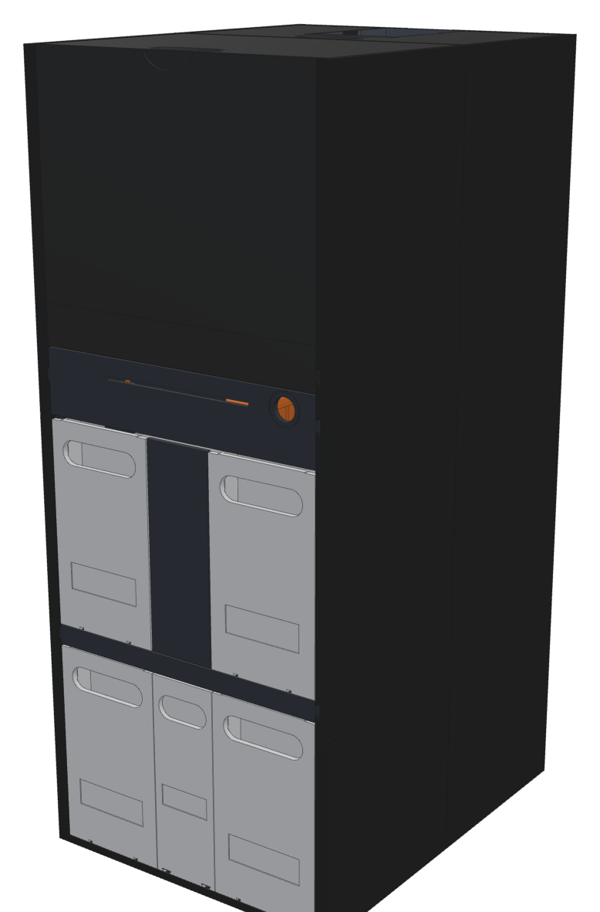
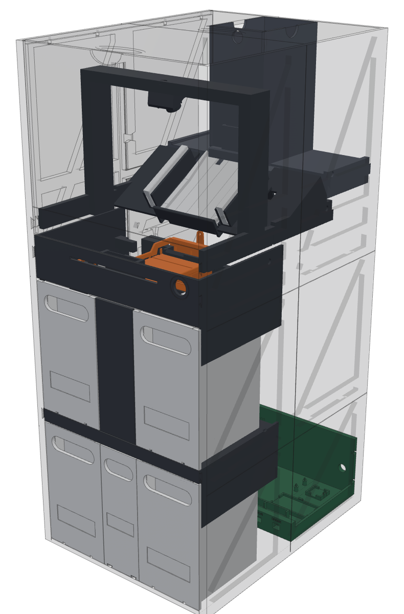

# Sorter Mk2

A full redesign of the sorter. It's one solid box, 244 mm wide, 308 mm deep and 580 mm tall. Every module slides into place on a dovetail rail and clicks home on a magnet, so there are no screws and no glue anywhere. It has four identical bins with handles, a 450-card magazine you load from the top, and one plug with one power button.

- **Print file:** [`../bambu/MTG_Sorter_Mk2.3mf`](../bambu/MTG_Sorter_Mk2.3mf). It has 31 plates in print order, with the settings already applied. Answer **No** to "load as a single object".
- **Print config:** [`../bambu/presets/mk2/`](../bambu/presets/mk2/README.md). It has the same settings as eight Bambu Studio process presets, plus a table of which preset and colour each part takes. [`../bambu/MTG_Sorter_Mk2_Print_Config.zip`](../bambu/MTG_Sorter_Mk2_Print_Config.zip) is the same folder as one download.
- **Parts to buy:** the Amazon.ca list in the [parts doc](https://claude.ai/artifact/5m2BNyQTrVAmBZscmgdgWu). It has 17 items, and you reuse your Pi 5, camera, PCA9685, DRV8833, light strip and MG90S servos.
- **Design notes:** [Redesign the sorter with no screws](https://claude.ai/artifact/Ug65EkUTzifY95Legm4BDj).

 

## How a card goes through it

1. **Magazine and feeder** (top back). This is the feeder v4 that worked (0 doubles in 125 feeds), with a magazine 2.3 times as tall. The shoe rests on the wheels by its own weight, with a cork pad over each wheel, so nothing needs adjusting. A stronger 60 RPM N20 drives it, and two PTFE strips under the stack let the bottom card slide out.
2. **Scan bed.** It slopes at 30°, with the camera 120 mm above the card and square to it. The card slides down on four PTFE lands into a 65 mm centring channel and stops on the **stop bar**. Light comes up through the white bed from a light box underneath, and from two side light bars that sit outside the angle where foil glare reaches the lens. Polarizer film goes in front of the lens and the bars.
3. **The stop bar drops.** It pivots 58 mm up the slope and turns 18°, so its face drops almost straight down, about 9 mm below the bed. It never pushes the card back up the slope. The card slides off the edge on its own and lands flat on **level 1**.
4. **Sorting:**
   - **Bin 1 (left) or bin 2 (right):** level 1's pusher slides the card sideways, slowly, off the floor into the bin.
   - **Bin 3 or bin 4:** level 1's two trapdoors open together, and the card falls flat down the shaft onto **level 2**. Level 2's pusher then moves it left or right.

The drop simulation (`sim/drops.py`, `sim/push.py`) had every card landing flat. That held for every friction value tried and for pusher speeds of 100 to 150 mm/s.

## Print

1. **Plate 01 first: the fit coupon** (about 40 minutes). It tests every joint at a few sizes, so pick what feels right using the notes in `coupon.scad`. If any size differs from `fit.scad`, send the numbers and the 3MF gets rebuilt. Every part takes its sizes from `fit.scad`.
2. **Then plates 02 to 31, in order.** The frame comes first, so each later module can be test-fitted as it comes off the printer. To catch a problem before it costs a lot of filament, stop and check at these points:
   - **After plates 02, 03 and 04:** join the base, then slide the first wall tile onto the base's edge dovetail. It should slide with a firm push and not lift off.
   - **After plate 17 (level 2):** check a hall sensor lies flat in a shelf pocket, and a bin (plate 16) slides onto the shelf's runners and clicks onto its magnet.
   - **After plate 19 (pushers):** build level 2's pusher on the bench: carriage on the guide, lever pin in the fork, servo clicked into its box. Move the horn by hand from end to end. The paddles should run the whole width without catching, and the servo shouldn't pull back out. Slide a TCRT5000 into a sensor holder, and the holder into its groove.
   - **After plate 21 (scan carrier):** click the stop bar servo into its box and check the bar swings freely.
   If anything binds, stop and send a photo before printing the rest.
3. **Settings are per part and already set in the file:**
   - Every part: 4 walls, 20% gyroid infill.
   - Walls, base and everything that carries load: 5 walls, 30% infill.
   - Tall parts: a 5 mm brim.
   - The level frames, scan carrier, camera arch, feeder stand and electronics tray: tree supports, set to auto.
   - The shoe, roller, levers and keys: solid.
   - The scan bed: ironed on top.
4. **Don't press Arrange, and leave Support off on the Global tab.** Each plate is already laid out, centred so the brims and supports stay on the bed. The parts that need supports (the level frames, the scan carrier, the camera arch, the feeder stand, the pushers and the electronics tray) have them switched on themselves. Arrange repacks parts from other plates onto the wrong plate and pushes them to the edges, where their supports run off the bed. If that happens, close the project without saving and open the 3MF again.
5. **Swap to white PLA for the plates marked WHITE:** bins, trapdoors, drawer, scan bed and light bars. Everything else is black.

The wall tiles are 250 mm long and use the A1's whole bed. There's no prime tower with one colour, so they fit.

## Assemble

Nothing is screwed or glued. Steel pins press into their holes, magnets press into their pockets, and everything else slides or clicks.

The same steps with a picture each: [`MTG_Sorter_Mk2_Picture_Assembly.html`](MTG_Sorter_Mk2_Picture_Assembly.html) (rebuild it with `python3 guide/build_guide.py`).

1. **Base:**
   - Lay the four base tiles on the table.
   - Press a bowtie key into each socket across the seams (5 keys).
   - Push 3 x 16 mm pins into the seam holes.
   - Press the magnets in: the drawer's, and each bin's two.
2. **Walls:**
   - Each wall is 2 x 3 tiles, joined the same way (9 keys per wall, plus pins).
   - Slide each wall onto the base from the front. The dovetail along the base's edge runs in the groove under the wall, so the walls and base stay locked together even if you lift the machine by its walls.
   - Press the rail magnets in near the closed end of each rail, and the lid magnets in the top ledge.
3. **Level 2** (do this on the bench, before it goes in):
   - Press the lever's horn into its pocket and a 3 x 16 mm pin through the lever's end, so 5 mm stands out of its flat face.
   - Lay the carriage on the frame's guide, slide it to the middle, and lower the lever in from above so its pin drops into the fork at the top of the crossbar.
   - Slide the pusher servo in from the back of its box, shaft first into the lever's horn, until the latch clicks over the back of its body. To take it out, lift the latch finger with a fingernail and pull.
   - Lay a hall sensor flat in each shelf's pocket, legs back along the groove (it reads the bin's magnet through the bin's floor).
   - Slide the frame in from the front on the lowest rail until its magnet clicks.
4. **Level 1:**
   - Same as level 2.
   - Then slide the two door servos in from the left until their latches click, each horn in its door's pocket.
   - Push a 3 x 10 mm pin through each door's right knuckle.
   - Fit the column front and the back liner. They line the shaft the cards fall down.
   - **Bin-full sensors:** slide a TCRT5000 module into each of the four holders (sensor end first, sensor facing out of the open side), then slide each holder's tongue back into the groove in the frame's stiffener behind its bin. The left holders are the same part turned upside down. The sensor looks through the slot in the bin's back wall, and the bin in front keeps the holder in its groove.
5. **Scan module:**
   - Fit the stop bar: a 3 x 10 mm pin through the left arm, and the servo's horn in the right arm.
   - Stick the LED strip pieces into the light box and the light bars, and drop the bars into their slots with the polarizer strips in front.
   - Press the bed into the carrier's rim until it clicks under the four lips.
   - Slide the carrier in from the front on the scan rail.
   - Slide the camera arch in after it. A key joins each of its feet to the carrier's skids.
   - Clip the camera onto its pegs, put the polarizer disc in the hood and twist the hood on.
6. **Feeder cartridge:**
   - Lay the motor in its pod and snap the motor lid over it. Fit the roller on the shaft.
   - Drop the magazine onto the stand's ridge.
   - Stick the two PTFE strips in the magazine floor's tracks and the cork pads on the shoe.
   - Slide the cartridge in from the back on the top rail. The upper back panel comes out to let it in.
7. **Electronics tray:**
   - Fit the boards on their pegs, the relay and DRV8833 in their cradles, and the Wagos in their holder.
   - Snap the comb over the PCA9685's servo plugs.
   - Slide the tray in from the back.
8. **Covers:**
   - Drop the back panels into the back grooves.
   - Drop the front cover in from the top.
   - Lay the two lid halves on the ledge, where the magnets hold them.
   - Slide the drawer and the four bins in.

**Cables** run in the walls' trunks (one in each wall at y 76, plus a branch to the feeder) under click-in lids. Every lid has a wire notch every 30 mm on its back edge: put the lids in notches to the back, and a wire drops into the trunk wherever it meets it. Every module's harness ends in a labelled JST-XH plug at the tray's patch bar, so you can take any module out without cutting or soldering anything. Nothing moves behind the bins or under the back beams, so that's where wires cross to the trunk:
- **Front door servo:** up into the channel along the top of level 1's left side, back along it, then into the left trunk.
- **Back door servo and the bin 1 and 2 full sensors:** down behind the bin, under level 1's back beam, into the trunk.
- **Bin 1 and 2 seated sensors:** along the groove from the pocket to behind the bin, then up and back into the trunk above level 2's pusher (keep them above the top of level 2's fork).
- **Bin 3 and 4 full sensors:** down behind the bin, under level 2's back beam, into the trunk. Their seated sensors' wires run under the base to the tray, as before.
- **Pusher servos:** straight from the back of each servo box to the trunk, behind the levers.

**PTFE tape (1/2 inch):**
- **Scan bed lands:** cut the tape in half lengthwise for the four 6.5 mm lands.
- **Magazine floor:** two full-width strips.
- **Level floors (only if cards drag):** one strip along each floor, between the paddle fingers' groove and the pocket wall.

## Power: one plug, one button

```
5 V 10 A brick ─ panel jack (back) ─┬─ Wago 5 V ─┬─ USB-C pigtail → Pi 5 (always fed)
                                    │            └─ relay COM ─ NO ─ Wago "switched 5 V"
                                    │                                 ├─ PCA9685 V+ (servos)
                                    │                                 ├─ DRV8833 VCC (feeder motor)
                                    │                                 ├─ light strip 5 V
                                    │                                 └─ button's LED ring (lit = ready)
                                    └─ Wago GND ─ everything's ground (Pi, PCA, DRV, strip, sensors)
```

- **Power button.** It's a 16 mm momentary button on Pi 5's **J2** pads, which means soldering a 2-pin header onto J2. That is the only soldering in Mk2. Press it to boot, press it to shut down cleanly, and hold it to force off.
- **Relay.** It's driven by **GPIO22**, with the module's trigger jumper on HIGH. The app closes it once it has started and opens it when the Pi shuts down. Until then the servos, motor and lights have no power, so nothing twitches at boot.
- **The Pi 5 on a non-PD supply.** Run `sudo rpi-eeprom-config --edit` and add `PSU_MAX_CURRENT=5000`. That stops the "power supply not capable of 5A" warning, and the brick does supply it.
- **Never use 12 V.** Mk2 has no regulator.

## Heat

The heat comes from the Pi 5 (with its Active Cooler) and the relay in the electronics tray at the bottom back, plus the servos and motor when they move. Cool air comes in low through the slots in the tray's back plate, rises through the back of the machine (behind the levels, where nothing else is), and leaves through the louvred vents in both back panels and round the magazine's opening in the lid. The louvres slope down to the outside, so warm air gets out but light from the room, which comes from above, can't reach the scan bed.

## Pin map

| What | Where | Notes |
|---|---|---|
| Stop bar servo | PCA9685 ch 0 | as the old stop pins |
| Level 1 pusher servo | PCA9685 ch 1 | replaces the tilt tray |
| Front trapdoor servo | PCA9685 ch 2 | |
| Back trapdoor servo | PCA9685 ch 3 | |
| Level 2 pusher servo | PCA9685 ch 4 | |
| Feeder motor | GPIO17 / GPIO27 → DRV8833 IN1 / IN2 | unchanged |
| Light strip data | GPIO10 (pin 19) | unchanged |
| Relay | GPIO22 | new |
| Bin seated (hall A3144), bins 1 to 4 | GPIO5, 6, 13, 26 | new, pull-ups on |
| Bin full (TCRT5000), bins 1 to 4 | GPIO16, 20, 21, 12 | new |
| Beam (spare IR input) | GPIO24 | optional |
| Power button | Pi 5 J2 | new |

Servo plugs: brown is GND, orange is 5 V, yellow is signal. Every servo reaches the PCA9685 through a 300 mm extension in the wall trunk.

## Software changes Mk2 needs

The app still drives Mk1 (a tilt tray and stop pins). These changes come once the machine is built:

- **New parts:** `stop` (ch 0, up and down), `push1` (ch 1) and `push2` (ch 4), each with left, centre and right, plus `door_f` (ch 2) and `door_b` (ch 3), each open and closed. All of them are new mechanisms, so each gets calibrated on the Machine page. Your Mk1 angles don't carry over.
- **Sort sequence:**
  1. Stop bar down.
  2. The card lands on level 1 (about 0.3 s).
  3. **Stop bar up again before anything else moves.** When it's down it hangs over level 1's pusher, so the pusher must stay at the centre until it's back up.
  4. For bin 1 or 2: push1 goes to that side and back to centre.
  5. For bin 3 or 4: both doors open, the card drops (about 0.4 s), the doors close, then push2 goes to that side and back.
- **Pusher speed:** about 120 mm/s, so about 0.6 s per stroke. The scotch-yoke lever already slows the paddle at both ends of its travel. Move the servo at a steady rate through ±80°.
- **Relay:** GPIO22 high at start, low at shutdown. Home moves the doors shut, the pushers to centre and the stop bar up.
- **Feeder:** the 60 RPM motor feeds the card at about 90 mm/s, so start with `FEEDER_SECONDS` around 1.0 and let the camera's landing check stop it, as now.
- **Bin sensors:** pause a run if a bin is pulled out (its hall sensor) or full (its IR sensor), and say which on the Run page.

## Checking the design

- **`python3 check.py`:** clash checks between every part, at every position of every moving part. Each must come out "clear". It covers both pushers at every eighth of their stroke, open doors, the stop bar's swing, the feeder wheels' sweep, the bin-full sensor holders, and a card's path through both levels. It also checks that each lever's pin stays inside its carriage's fork at every position, that every servo sits free in its pocket, and (the `_latch` checks, which must come out "CLASH") that each servo pulled back 2 mm runs into its latch.
- **`python3 export.py`:** writes every printed part to `stl/mk2_<part>.stl`, turned the way it prints.
- **`python3 meshcheck.py`:** checks every exported part before it goes in the 3MF: one solid piece (no loose bits, no sealed hollows), watertight, fits the A1's bed, sits flat on the plate, and how much overhang needs support.
- **`python3 ../bambu/make_mk2.py`:** builds the 3MF from those STLs, and writes the print config (`presets/mk2/` and the zip) from the same settings. `--config` writes only the print config.
- **`sim/`:** the 2D drop and push simulations behind the bed angle, the drop heights and the pusher speed.
